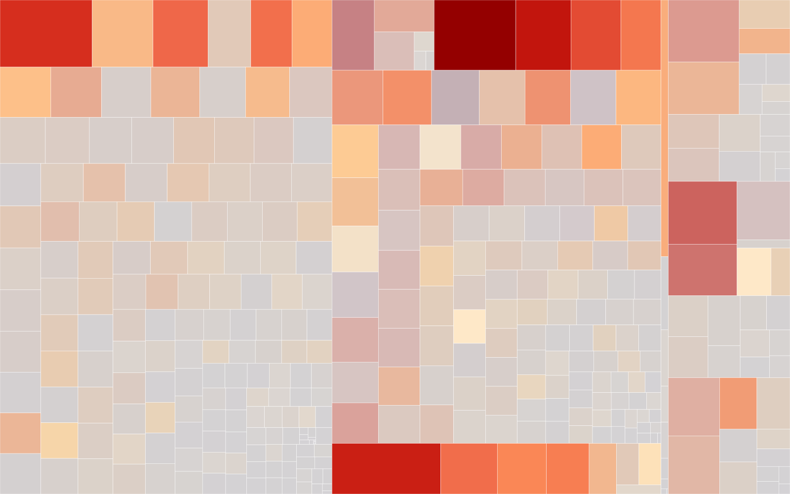
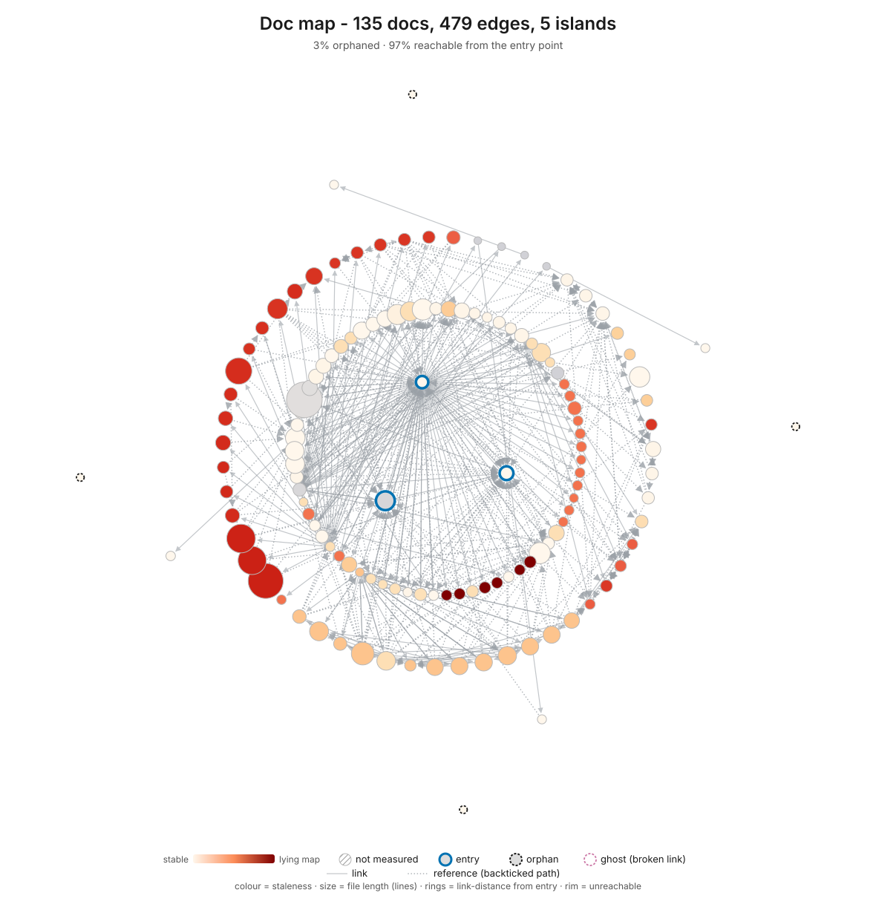

# Codebase Assessment: ai-native-toolkit

_Generated 2026-11-20. Generated by `/assess` v1.225.0._

**Score: 7.5 / 8 - AI-Native** - a readiness snapshot, not a verdict · Keyhole: 27 structural concerns (14 hidden coupling, 2 self-referential tests, 11 accretion ratchet), 3 safe zones.

Six weeks and a fleet layer later, the scaffolding still holds. Both packages type-check strict and lock their dependencies, `make check` is named in `CLAUDE.md` and resolves, and every one of the 135 docs is reachable again now that the `/doc-contradictions` eval prompts are linked from their cases. The score stays at 7.5. The last half point is still Layer 6, and the next step is the floor scripts' accretion. Their same-commit tests were reviewed and rewritten from the clause text in #410.

_Note: Mutation testing was not run. Layer 6 (Coverage) is capped at Partial and truth-pressure remains unproven._

> **Agents start here.** The prioritized Top 3 actions below are also machine-readable in `.assess/actions.json` (schema v2: every entry carries `rank`, `action`, `done_when`, and `scope_fence`, plus the lifecycle fields `status` / `claimed_by` / `completed_sha` and a derived execution `mode`). Read that file to pick up the work - even with a smaller model - without parsing this report's prose.

## Top 3 Actions

All three are the prescribed attention rows: the two floor scripts, which carry two findings each, then the test file that only ever grows.

| # | Action | Layer | Effort | Command / First Step | Done when | Scope fence | Hotspot files this addresses | Issue |
|---|--------|-------|--------|---------------------|-----------|-------------|------------------------------|-------|
| 1 | Extract the per-file branches of `cmd_markers` in `scripts/floor_check.py` (fn ccn 22) into named helpers in the same file, behind characterization tests | 3 | medium | Pin `cmd_markers`' current output for a marker added, removed and unchanged in `scripts/tests/test_floor_check.py`, then extract | `cd scripts && uv run --locked pytest` passes; lizard scores `cmd_markers` at 15 or less; the file's `.file-size-ratchet.toml` ceiling does not rise | Floor core: the PR needs the maintainer's `floor-signoff`. The file stays one standalone file (CI runs the base ref's copy via `git show`), so helpers stay inside it; no behaviour change | `scripts/floor_check.py` | - |
| 2 | Split `check_workflow_wiring` in `scripts/floor_anchor.py` (fn ccn 16) into one helper per wiring check, behind characterization tests | 3 | medium | Pin each failure message `check_workflow_wiring` can return in `scripts/tests/test_floor_anchor.py`, then extract | `cd scripts && uv run --locked pytest` passes; lizard scores every function in the file at 15 or less; the file's ratchet ceiling (1,067 lines) is lowered to its new length | Floor core: the PR needs `floor-signoff`. No change to which workflows or checks the anchor accepts | `scripts/floor_anchor.py` | - |
| 3 | Split `skills/assess/tests/test_complexity_treemap.py` (`accretion_ratchet`; 1,227 NLOC, 1,798 lines held at its ratchet ceiling) by concern, moving tests unchanged | 3 | medium | Group its tests by the treemap stage they exercise (scoring backends, stats sidecar, layout, render) into `test_complexity_treemap_<stage>.py` files | `make test-assess` passes; every new file is under 800 lines; the file's `.file-size-ratchet.toml` ceiling is deleted; the collected test names are identical before and after | Move tests only; no assertion or fixture changes | `skills/assess/tests/test_complexity_treemap.py` | - |

The prescribed rows are two floor files with two findings each, then a test file with one, so the ranking separates them. The `coverage_report` gap action falls outside the three slots and is listed under Additional Opportunities.

### Why these three?

`self_referential_tests` reads the git history, so it keeps flagging both floor scripts. The human review it asks for was done in #410, which narrowed `FLOOR.md` clause iii and added tests written from the clause text. What remains on those two files is `accretion_ratchet`: each sits at a 1,067- or 1,070-line ratchet ceiling and has functions above the ruff threshold of 15 (`cmd_markers` 22, `check_workflow_wiring` 16). Characterization first keeps the constitutional gate's behaviour pinned while it shrinks. Action 3 retires the largest remaining test-file ceiling. The ratchet follows a file down, so the lines a split removes can come back only through a ceiling raise someone reviews.

## Snapshots

### Complexity - riskiest to change

The risk is still concentrated in `skills/assess/`: nine of the ten top hotspots are the engine auditing itself. Per-function ccn p95 is 9 against the ruff gate of 15, but lizard scores a few functions higher than ruff's mccabe allows (Layer 3 below).

### Doc navigability - can an agent find its way?

All 135 docs are reachable, with no orphans, no broken links and no lying maps. Links alone reach 93%; backticked doc paths carry the rest.

📈 Snapshot detail (commit, hotspots, navigability, lying maps)

#### Complexity profile

- **Measured at commit:** `3e966b6793c9` (2026-11-20)
- **Files scored:** 326
- **Churn window chosen:** last 12mo
- **Complexity profile:** per-function ccn p95 9 (max 33, over 6,121 functions); file-aggregate ccn p95 147 (max 264); p95 est. tokens 8,939 (max 19,418; code 19,418, data 0); p95 NLOC 532 (max 1,227; code 1,227, data 0)
- **Top hotspots** (composite `sqrt(effective_ccn) × sqrt(1 + commits) × sqrt(est_tokens)`, with `effective_ccn` the file aggregate weighted toward its worst function: a sub-linear blend of complexity, recent churn and context-window size, so a file high on several axes leads; a co-change breadth term was tested and left out, see the assess skill's `references/hotspot-cochange-experiment.md`). `est_tokens` is the char-based estimate (~chars/4), and `ccn` here is the **file aggregate**, with the worst single function in parentheses:
  1. `skills/assess/scripts/complexity-treemap.py` - 17,285 est. tokens (818 NLOC), aggregate ccn 201 (worst function `lizard_scores` 14), 45 commits in window
  2. `skills/assess/scripts/lib/keyhole_signals.py` - 18,003 est. tokens (860 NLOC), aggregate ccn 248 (worst function `render_findings_markdown` 11), 27 commits in window
  3. `skills/assess/tests/test_complexity_treemap.py` - 19,418 est. tokens (1,227 NLOC), aggregate ccn 189 (worst function `test_write_stats_tie_break_by_path_takes_first_ten_in_path_order` 6), 36 commits in window
  4. `skills/assess/scripts/lib/doc_graph.py` - 12,110 est. tokens (705 NLOC), aggregate ccn 209 (worst function `_derive_signals` 15), 24 commits in window
  5. `skills/assess/scripts/lib/git_churn.py` - 8,739 est. tokens (446 NLOC), aggregate ccn 138 (worst function `content_commit_clock` 31), 15 commits in window
- **Size units:** `loc` in the stats sidecar and every `LOC` label the core generates is NLOC (code lines without blanks or comments). The file-size ratchet and `wc -l` count physical lines, so `test_complexity_treemap.py` is 1,227 NLOC and 1,798 lines.
- **Keyhole budget:** the repo is ~1,146k est. tokens. No single file exceeds the ~200k keyhole budget; 1 subtree does: `skills` (~960k).

Size encodes estimated tokens, colour encodes cyclomatic complexity (dark red = high), and saturation encodes recent git churn (vivid = active).

_No hatching visible - mutation analysis was not run. The hatching would mark covered-but-unpinned code (tests that execute without constraining). Run `/assess` and accept the mutation offer to enable it._

#### Where to focus testing

Coverage data: none found - test signals are heuristic-only.

Coverage gate: `scripts/pyproject.toml:46` (`[tool.coverage.report] fail_under` 91); `skills/assess/pyproject.toml:52` (`[tool.coverage.report] fail_under` 93)

| File | Risk | Test Signal | Suggested Action |
|------|------|-------------|------------------|
| `skills/assess/scripts/complexity-treemap.py` | High | Test file present, coverage unmeasured | Measure coverage |
| `skills/assess/scripts/lib/keyhole_signals.py` | High | Test file present, coverage unmeasured | Measure coverage |
| `skills/assess/tests/test_complexity_treemap.py` | High | Test file present, coverage unmeasured | Measure coverage |
| `skills/assess/scripts/lib/doc_graph.py` | Medium | Test file present, coverage unmeasured | Measure coverage |
| `skills/assess/scripts/lib/git_churn.py` | Medium | Test file present, coverage unmeasured | Measure coverage |
| `skills/assess/scripts/lib/wiki_writer.py` | Medium | Test file present, coverage unmeasured | Measure coverage |
| `skills/assess/tests/test_assess_core.py` | Medium | Test file present, coverage unmeasured | Measure coverage |
| `skills/assess/scripts/lib/scan_registry.py` | Low | Test file present, coverage unmeasured | Measure coverage |

`make check` writes a `coverage.xml` for each package, but none was present at the repo root when this run read it, so every row is unmeasured rather than uncovered. The coverage gates themselves are enforced in CI.

#### Doc navigability

Of 135 docs, all are reachable from `CLAUDE.md`, `README.md` or `docs/index.md` by following links and backticked doc paths. There are no orphans (docs nothing links to or cites), one connected island and no broken links. Links alone reach 93%; backticked citations carry the rest. The first pass of this run found four orphans, the `prompt.md` of each `evals/doc-contradictions/` case. This branch links each from its case `README.md`.

**Base docs per code directory:** the base-doc ratio is 0.333 (one in three code-containing directories holds its own base doc). `CLAUDE.md`, `skills/README.md` and the two `skills/assess/` READMEs cover the rest, so an agent still reaches them through a hub.

**Lying maps (stale docs of churning code):** none. A doc is *stale* when its subject code has moved since the doc's last content change. The first pass of this run flagged `skills/assess/SKILL.md`, `skills/assess/tests/README.md` and `skills/README.md`. This branch indexes the 21 test suites the tests README did not list, adds the fleet history, compare and heat-map scripts to `skills/README.md`, and documents the uncapped `files` list and the approximate scc CCN cells in `skills/assess/SKILL.md`. The top stale hubs (`docs/floor-anchor-proof.md`, `skills/skill-forge/references/judge-lenses.md`) are matched only against whole-repo churn, which is too coarse (low confidence) to call a lie.

#### What changed since last run

_Diff suppressed: schema version changed 5->7._ The committed snapshot dated from 2026-10-11 (plugin 1.96.0), before the stats sidecar gained its uncapped `files` list. `.assess/index.md` still records each hotspot's entry and exit.

📊 Full scorecard (per-layer evidence & gaps)

The two headline metrics measure **different things and are never combined.** The 0-8 score asks whether the scaffolding is in place to catch problems. The Keyhole Readiness summary counts today's structural concerns and safe zones from the ten cross-layer findings.

The **What it asks** column is the question that layer answers for an agent working here. The **Band** orders them by dependency: read-side first, then write-side enforcement, then meta.

| Layer | What it asks | Band | Status | Evidence | Gap |
|-------|--------------|------|--------|----------|-----|
| 0: Agent Instructions & Navigability | Can I build a true map of this codebase before I touch it? | read | Present | `CLAUDE.md` grades A: 157 lines, 1,759 words, verified commands including `make check`, 0 stale references, no size penalty; base docs such as `skills/assess/scripts/lib/README.md` and the `docs/index.md` map; 100% reachable, 0 orphans, 0 broken links; `claude_config` 0 findings; about 3,310 tokens loaded at session start; no `AGENTS.md` | No `scripts/README.md`, and the base-doc ratio is 0.333. `.github/claude-review-instructions.md` grades B: 249 always-on lines, flagged, no relocatable section (a review-bot prompt, not loaded at agent start) |
| 1: Runtime Legibility / Liveness | Can I see which parts are live, which need attention, and which are dead weight? | read | Missing | No `.mcp.json` and no `OBSERVABILITY.md`; `CLAUDE.md` states "No application runtime.", so liveness is read through complexity, churn and reachability, not telemetry | No runtime by design. The dead-code scan did not run: vulture was not on PATH, and knip (JavaScript) degraded honestly |
| 2: Code Design | Will the type-checker catch my mistakes? | write | Present | `disallow_any_generics = true` in `skills/assess/pyproject.toml` and `strict = true` in `scripts/pyproject.toml`; `uv run --locked mypy` in `.github/workflows/tests.yml` | `scripts/` keeps three floor-protected mypy overrides |
| 3: Linters | Are complexity and style bounds enforced, or will my code drift? | write | Present | ruff `max-complexity = 15` in `skills/assess/pyproject.toml`, and `select = ["E4", "E7", "E9", "F", "C901"]` in `scripts/pyproject.toml`; `uv run --locked ruff check .` in `.github/workflows/tests.yml`; `.file-size-ratchet.toml` (`default_limit = 800`) enforced by `tests/test_file_size_ratchet.py` | Lizard scores some functions above 15 that ruff's mccabe passes: `git_churn.content_commit_clock` 31, `scan_registry.validate` 27, `floor_check.cmd_markers` 22, `assess_report.render_exclusion_disclosure` 19 |
| 4: Architecture Tests | Are the structural conventions executable, or just folklore? | write | Present | `skills/assess/tests/test_self_architecture.py`, `tests/test_plugin_contract.py` and `tests/test_file_size_ratchet.py`, run by `pytest -v tests/` in `.github/workflows/tests.yml` | One import rule |
| 5: CI Pipeline | Does something automatically catch a bad change before it merges? | write | Present | `.github/workflows/tests.yml` (`uv run --locked pytest -v`); the `Makefile`'s `check: lock-check test-assess test-scripts test-contract lint`; both manifests locked (`skills/assess/uv.lock`, `scripts/uv.lock`); the Layer 5 cap does not apply; slowest CI median 113s against a 600s target | CodeQL and pip-audit are advisory |
| 6: Coverage Gates | Do the tests constrain behaviour, or just execute lines? | write | Partial | `fail_under = 93` in `skills/assess/pyproject.toml` and `fail_under = 91` in `scripts/pyproject.toml`, run with `--cov=scripts` in `.github/workflows/tests.yml`; `mutmut` in `.github/workflows/mutation.yml`. truth-pressure unproven (mutation not run) | No mutation results in this run, and no coverage report at the repo root |
| 7: Code Review Bots | Is there design-level feedback on every change? | write | Present | `.github/workflows/claude-review.yml`; every one of 30 sampled merged PRs carries a bot review, and 20% are approved | Review is advisory on this solo-maintainer repo; no `.coderabbit.yaml` is committed |
| 8: AI Project Mgmt (capstone) | Do learnings feed back into the contracts, or evaporate? | meta | Present | `CLAUDE.md` `## Marathon Configuration` with the `marathon-retros.md` retro log; `skills/marathon/SKILL.md` applies the retro log's Template Changes table before spawning teammates | The retro log is per-machine; no `.taskmaster` in the repo; agent_ops all false (neutral) |

### Score derivation (worked)

L0 1 + L1 0 + L2 1 + L3 1 + L4 1 + L5 1 + L6 0.5 + L7 1 + L8 1 = **7.5**, under the cap of 8: 0.94 of 8, AI-Native.

### Maturity Level

| Score | Level | Description |
|-------|-------|-------------|
| 0-2 | Not Ready | Agent will produce inconsistent, unvalidated code |
| 3-4 | Basic | Norms exist but aren't enforced. Agent works but drifts |
| 5-6 | Solid | Contracts catch most issues. Agent is productive |
| 7-8 | AI-Native | System self-improves. Agents work reliably at scale |

### What this score unlocks

The maturity band bounds how much agent **autonomy** this repo's contracts can safely absorb, in the vocabulary of the adoption ladder ([Steps of AI Adoption](https://www.threads.com/@boris_cherny/post/Da4CkQnEea-), B. Cherny, 2026).

| Band | Contracts support up to | Why |
|------|------------------------|-----|
| Not Ready | Step 1 (Assisted) - one supervised agent | No verification contracts; a human must review every change |
| Basic | Step 1-2 boundary | Parallel agents are risky until L5/L6 self-verification holds |
| Solid | Step 2 (Parallel) - ~10 agents, one orchestrator | Self-verification and review automation absorb parallel diffs |
| AI-Native | Step 3 (Supervised autonomy) - background routines | Contracts plus L8 orchestration can absorb autonomous loops |

**This is a bound, not a claim about how the team actually works.**

🔎 Cross-layer findings & lying signals (keyhole detail)

### Instruction placement

- `.github/claude-review-instructions.md` - 249 of 249 lines always-on (100%), flagged. No section clearly belongs outside the always-loaded layer.

**Loaded in full (informational):** `skills/marathon/SKILL.md` (skill, 608 lines, 39% always-on, 5 relocatable sections), `agents/assess-layer-scorer.md` (agent, 602 lines, 15%), `skills/huddle/SKILL.md` (skill, 524 lines, 31%), `skills/assess/SKILL.md` (skill, 481 lines, 26%), `skills/issues/SKILL.md` (skill, 465 lines, 11%), `skills/assess-findings/SKILL.md` (skill, 441 lines, 11%), `skills/assess-pr/SKILL.md` (skill, 430 lines, 30%), `skills/tm/SKILL.md` (skill, 415 lines, 37%), and smaller skills. These are loaded only when invoked, so they carry no grade effect. Section-level homes are in `.assess/run-context.json` `instruction_placement.loaded_in_full`.

### Agent harness

No committed hooks, env, apiKeyHelper or MCP servers. No findings: no tracked `.env` or `settings.local.json`, and no hidden Unicode in instruction files.

### Agent environment

- **Setup:** `Makefile` (`make setup`)
- **Check:** `CLAUDE.md:23` `make check`
- **Pinning:** every manifest locked (`scripts/uv.lock`, `skills/assess/uv.lock`)
- **CI duration:** slowest median 1.9 minutes on `main` over 50 runs, against the 10-minute guidance

## Cross-Layer Findings (Keyhole Readiness)

The two floor scripts lead the attention list again: they still carry `self_referential_tests` (their tests arrived in the same commit as the code), now alongside `accretion_ratchet`. There is no `lying_map`, `unactioned_intent` or `untrusted_hotspot` in this run; the last is silent because the opt-in mutation pass did not run.

### hidden_coupling

Action: investigate the seam

Paths:
- scripts
- scripts/contract
- scripts/tests
- skills/assess
- skills/assess/scripts
- skills/assess/scripts/lib
- skills/assess/scripts/lib/test_pressure
- skills/assess/tests
- skills/assess/tests/fixtures
- skills/fleet
_... 4 more omitted; full list in `.assess/run-context.json` `derived_findings` (`hidden_coupling`) `paths`_

### self_referential_tests

Action: request human review - tests verify internal consistency, not truth

Paths:
- scripts/floor_anchor.py
- scripts/floor_check.py

### accretion_ratchet

Action: refactor down: extract, delete dead code, or split the file

Paths:
- scripts/floor_anchor.py
- scripts/floor_check.py
- scripts/tests/test_floor_anchor.py
- scripts/tests/test_floor_check.py
- skills/assess/scripts/assess_report.py
- skills/assess/scripts/lib/git_churn.py
- skills/assess/scripts/lib/test_pressure/mutmut3.py
- skills/assess/scripts/lib/wiki_writer.py
- skills/assess/tests/test_assess_finalize.py
- skills/assess/tests/test_complexity_treemap.py
_... 1 more omitted; full list in `.assess/run-context.json` `derived_findings` (`accretion_ratchet`) `paths`_

### refactor_boundary

Action: safe to hand an agent in isolation

Paths:
- docs/design
- docs/design/2026-09-modernization
- skills/tm

### Attention List (Priority Order)

- scripts/floor_check.py (score 2): accretion_ratchet, self_referential_tests
- scripts/floor_anchor.py (score 2): accretion_ratchet, self_referential_tests
- skills/assess/tests/test_complexity_treemap.py (score 1): accretion_ratchet
- skills/assess/scripts/lib/git_churn.py (score 1): accretion_ratchet
- skills/assess/scripts/lib/wiki_writer.py (score 1): accretion_ratchet
_... 5 more omitted; top 10 ranked rows in `.assess/run-context.json` `attention`_

✅ Strengths & further opportunities

### Strengths

- **The doc map is whole.** Of 135 docs, all are reachable from `CLAUDE.md`, `README.md` or `docs/index.md`, with no broken links and no lying maps. The per-suite index in `skills/assess/tests/README.md` names every test file.
- **The working environment is reproducible.** `make setup` and `make check` mirror the required CI jobs, both `uv.lock` files are checked in CI, and the slowest CI median is under two minutes.
- **Two-way size and type ratchets.** mypy strict with `disallow_any_generics`, ruff C901 at 15, and an 800-line file ceiling that follows a file down.
- **The deterministic core degrades by construction.** Every scan-table entry now degrades to an unavailable marker unless it names a gate reason (#639), so a failing scan reads as unavailable, never as a clean zero.
- **Safe zones for isolated work.** `refactor_boundary` names `docs/design`, `docs/design/2026-09-modernization` and `skills/tm` as places an agent can be handed work in isolation.

### Additional Opportunities

- **Coverage report for `/assess` (gap action):** generate a line-coverage report (`coverage.xml` or `lcov.info`) at the repo root and read it for the top hotspots first (`skills/assess/scripts/complexity-treemap.py`, `skills/assess/scripts/lib/keyhole_signals.py`, `skills/assess/tests/test_complexity_treemap.py`). `docs/contributing/ci.md` has the recipe.
- **Layer 6 to Present:** accept the opt-in mutation pass on the next run. The last pass (2026-10-11) measured `scripts/floor_anchor.py` at 437 of 1,017 surviving mutants; #410 has since added tests written from the clause text.
- **Layer 3 watch list:** `git_churn.content_commit_clock` (31), `scan_registry.validate` (27) and `assess_report.render_exclusion_disclosure` (19) score above 15 under lizard. Each is a characterization-first extraction candidate, not a gate failure.
- **Layer 0 margin:** a `scripts/README.md` base doc would let the build and floor scripts stop relying on `CLAUDE.md` alone.
- **Run `/doc-contradictions`:** `/assess` does not compare docs against each other.

🧭 How to read this report (framing & method)

**What this is ultimately measuring.** Whether an AI contributor here behaves like a brand-new hire or like an engineer with eighteen months of context. The difference is *externalized context*. **Legibility you can trust, not omniscience you can't.** The write-side layers are guardrails that protect any contributor from costly mistakes by design; a **Missing** there means the codebase asks the contributor to be careful where it could make the wrong move hard to make.

This is an improvement roadmap, not a verdict. It measures one thing: **is the codebase kept honest, not just scaffolded.** It pairs three views: the complexity heatmap, the doc graph, and the 0-8 score across the read, write and meta bands. A codebase can be 8/8 and still on fire, or 2/8 with a calm treemap; the views matter together.

**Layer 1 on a repo with no runtime.** The complexity heatmap and the dead-code scan are its observability; a Missing means look through those instruments, not that the agent is flying blind.

**The legacy-transition lens.** Characterization tests before refactoring (Feathers, *Working Effectively with Legacy Code*), Strangler Fig over rewrites (Fowler; Spolsky, *Things You Should Never Do*), hotspots and change-coupling as the worklist (Tornhill), and a per-component decision among the 7 Rs.

**How it's measured.** Static analysis, git history and graph metrics over the docs and code. The model writes only the prose around those numbers.

🤖 Machine-readable data (for agents)

If you are an agent working in this repo, the `.assess/` directory is actionable feedback written for you:

- `.assess/assess-report.md` - this report: the scorecard, the findings, and the Top 3 Actions with exact commands and file paths.
- `.assess/run-context.json` - the full data bus (findings, attention, keyhole summary, prescribed actions, stats, diff); written by each run, not committed here.
- `.assess/complexity-stats.json` - complexity / estimated-token / LOC percentiles, the keyhole-budget rollup (`est_tokens.budget`), the ranked file lists (`top_hotspots`, `top_complex`, `top_large`) and `files`, every scored file's `{path, ccn}`.
- `.assess/hotspots/<file>.md` - per-file briefings, each with a **Suggested actions** section. Read a file's briefing before you change it.
- `.assess/index.md` - the catalog of every hotspot ever flagged (current and graduated).
- `.assess/log.md` - append-only run history.

---

_Report generated by [`/ai-native-toolkit:assess`](https://github.com/bjcoombs/ai-native-toolkit). Install in any Claude Code session: `/plugin marketplace add https://github.com/bjcoombs/ai-native-toolkit` then `/plugin install ai-native-toolkit@ai-native-toolkit`._
