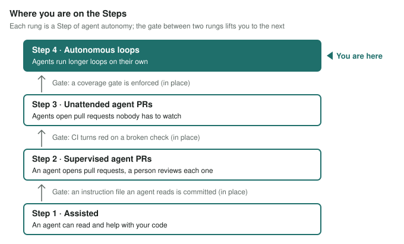
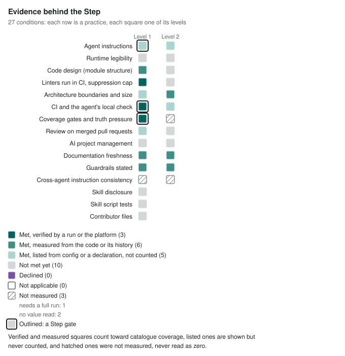
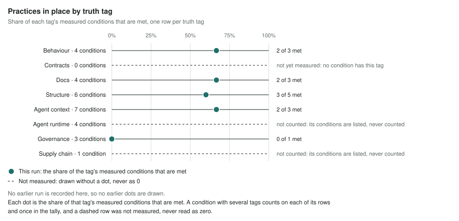
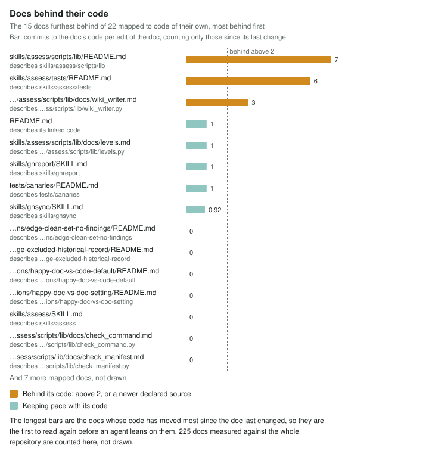
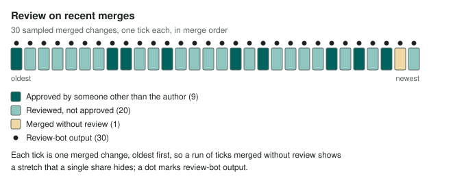

# Codebase Assessment: ai-native-toolkit

_Generated 2026-11-24. Generated by `/assess` v3.0.0._

[Step](https://github.com/bjcoombs/ai-native-toolkit/blob/main/docs/glossary.md#step) 4 of 4: agents run longer loops on their own.

Next: every gate holds; keep them in place to stay at Step 4.

Since last run: not known.

_New to these words? The [glossary](https://github.com/bjcoombs/ai-native-toolkit/blob/main/docs/glossary.md) explains [Step](https://github.com/bjcoombs/ai-native-toolkit/blob/main/docs/glossary.md#step), [gate](https://github.com/bjcoombs/ai-native-toolkit/blob/main/docs/glossary.md#gate), [practice](https://github.com/bjcoombs/ai-native-toolkit/blob/main/docs/glossary.md#practice), [level](https://github.com/bjcoombs/ai-native-toolkit/blob/main/docs/glossary.md#level), [evidence grade](https://github.com/bjcoombs/ai-native-toolkit/blob/main/docs/glossary.md#evidence-grade) and [truth tag](https://github.com/bjcoombs/ai-native-toolkit/blob/main/docs/glossary.md#truth-tag) in a sentence or two each._

## Since Last Run

- Closed since last run: not known (log.md records an earlier run, but its run-context.json is not here)
- Gates gained: not known (log.md records an earlier run, but its run-context.json is not here)
- Gates lost: not known (log.md records an earlier run, but its run-context.json is not here)
- Next blocker: none, every gate is held

**Step 4 · Autonomous loops · contracts in place**

Next: Step 4 is the top Step; it holds while its gates hold

Catalogue coverage: 9 of 15 [measured](https://github.com/bjcoombs/ai-native-toolkit/blob/main/docs/glossary.md#catalogue-coverage), 3 [verified](https://github.com/bjcoombs/ai-native-toolkit/blob/main/docs/glossary.md#evidence-grade) · 3 not measured (needs a full run: 1, no value read: 2) · model default-2026.11.23

By tag: behaviour 2 of 3 (NOT MEASURED: 1) · docs 2 of 3 · structure 3 of 5 · agent_context 2 of 3 (NOT MEASURED: 2) · agent_runtime 0 of 0 · governance 0 of 1 · supply_chain 0 of 0

Units: Step 3 (lowest unit) · 2 of 23 measured units at Step 4

Next unlock across units: a coverage gate is enforced, in one unit, moves 1 unit to its next Step

agents: a coverage gate is enforced. Learn from: scripts, skills/assess

skills/6hats: a coverage gate is enforced. Learn from: skills/assess, scripts

skills/ab-equivalence: a coverage gate is enforced. Learn from: skills/assess, scripts

skills/assess-findings: a coverage gate is enforced. Learn from: skills/assess, scripts

skills/assess-pr: a coverage gate is enforced. Learn from: skills/assess, scripts

16 more units have a sibling unit that holds their next gate

_A readiness snapshot, not a verdict._ · Keyhole: 68 structural concerns (16 hidden coupling, 3 stale doc over complex code, 37 unactioned intent, 12 accretion ratchet), 3 safe zones.

The toolkit still clears every Step gate on its own repository: CI runs the tests unmasked, ruff's `C901` at 15 and strict mypy gate both packages, coverage is enforced at 93% and 91%, and all six configured gates are stated in `CLAUDE.md`, so an agent learns the rules before it trips them. This snapshot is the first with scc, and it brought `skills/ghsync/scripts/ghsync.sh` and `skills/ghreport/scripts/ghreport.sh` into view for the first time: the two shell skills now lead the hotspot list. The next step is housekeeping rather than structure: 113 untracked suppressions now hold the linter practice at Partly in place, and 35 of them are the `# noqa: E402` lines in the two prescribed Python files below.

_Note: Mutation testing was not run. The "Coverage gates and truth pressure" practice is capped at Partly in place, and truth pressure remains unproven._

> **Agents start here.** The prioritized Top 3 actions below are also machine-readable in `.assess/actions.json` (schema v2: every entry carries `rank`, `action`, `done_when`, and `scope_fence`, plus the lifecycle fields `status` / `claimed_by` / `completed_sha` and a derived execution `mode`). Read that file to pick up the work - even with a smaller model - without parsing this report's prose.

## Top 3 Actions

Actions 1-3 are the three prescribed attention rows: the untracked suppressions in `assess_report.py` and `fleet.py`, and the accreting `ghreport.sh`. The two gap actions (a coverage report and the review-bot prompt's length) are under Additional Opportunities.

| # | Action | Practice | Effort | Command / First Step | Done when | Scope fence | Hotspot files this addresses | Issue |
|---|--------|-------|--------|---------------------|-----------|-------------|------------------------------|-------|
| 1 | Give the four `# noqa: E402` suppressions in `skills/assess/scripts/assess_report.py` a recorded reason: they follow the `sys.path` bootstrap, so each is needed, but none says why. Either append the reason inline (`# noqa: E402  # imports follow the sys.path bootstrap`) or move E402 into a per-file ignore for the script entry points | Linters run in CI, suppression cap | small | `rg -n "noqa: E402" skills/assess/scripts/assess_report.py` (lines 59-62) | `cd skills/assess && uv run --locked ruff check .` passes and every E402 suppression in the file carries a reason. Optional: a re-run no longer lists the file under `unactioned_intent` | Suppression comments or ruff config only. No import reordering and no other edits to `assess_report.py` | `skills/assess/scripts/assess_report.py` | https://github.com/bjcoombs/ai-native-toolkit/issues/1206 |
| 2 | Do the same for the 32 `# noqa: E402` suppressions in `skills/fleet/scripts/fleet.py`, which also follow a `sys.path` bootstrap (line 137) | Linters run in CI, suppression cap | small | `rg -n "noqa: E402" skills/fleet/scripts/fleet.py` | Running `uv run --locked ruff check ../fleet/scripts` from `skills/assess` reports no E402, and each suppression carries a reason or is replaced by one per-file ignore. Optional: a re-run no longer lists `fleet.py` under `unactioned_intent` | Suppression comments or ruff config only. Bringing `skills/fleet/scripts` under the CI lint job is a separate change (2a) | `skills/fleet/scripts/fleet.py` | https://github.com/bjcoombs/ai-native-toolkit/issues/1207, https://github.com/bjcoombs/ai-native-toolkit/issues/1208 (2a) |
| 3 | Split `skills/ghreport/scripts/ghreport.sh` along its seams into sourced helper files beside it: GitHub queries (`query_repo`), GitLab queries (`gitlab_api` to `query_project_gitlab`), the org and group settings section (`query_org_settings_github` to `render_settings`), and rendering (`render_table` to `emit_report`). It is 997 lines, ccn ~102 (approximate), and has only grown (12 commits, 6% deletions) | Linters run in CI, suppression cap | medium | `rg -n "^[a-z_]+\(\)" skills/ghreport/scripts/ghreport.sh` and group the 26 functions by the seams above | `uv run --with pytest --with pyyaml pytest tests/test_ghreport.py tests/test_ghreport_gitlab.py tests/test_gitbash.py` passes unchanged, the Windows Git Bash job is green, and no resulting file is over 800 lines | Move functions only, with no behaviour change. The standalone ZIP build must still ship every sourced file | `skills/ghreport/scripts/ghreport.sh` | https://github.com/bjcoombs/ai-native-toolkit/issues/1209 |

2a. Add `skills/fleet/scripts` and `skills/marathon/scripts` to the ruff and mypy runs in `Makefile` `lint:` and `.github/workflows/tests.yml`. Done when: both CI steps cover the two directories and pass. Tracked in https://github.com/bjcoombs/ai-native-toolkit/issues/1208.

### Why these three?

"It counts the TODO, FIXME and suppression markers that agents leave behind, so promised work does not pile up unseen." Actions 1 and 2 are that count's largest share: 35 of the 113 stale markers, all the same E402 pattern after a `sys.path` bootstrap. The suppressions are needed, so the fix is to record why, not to delete them; that turns 35 broken-looking promises into stated decisions, and drops the count toward the cap that holds the linter practice at Partly in place. Action 2 matters more than it looks: ruff does not run on `skills/fleet/scripts` today, so those 32 comments are inert and the C901 finding in `fleet.py`'s `main` (lizard ccn 54) goes unseen (2a).

Action 3 is the accretion fix where it is safe. `ghreport.sh` was invisible to every earlier snapshot because lizard does not read shell. Its functions already fall into four groups, so a move-only split (characterization through the existing `tests/test_ghreport*.py` first, then extract along the seams, Feathers-style) gives an agent four keyhole-sized files instead of one 997-line script. The ccn figure is scc's keyword count, so it is not the reason for the rank; the growth pattern and size are.

## Snapshots

### Complexity - riskiest to change

The two shell skills, `ghsync.sh` and `ghreport.sh`, now lead the hotspots beside `complexity-treemap.py` and `fleet.py`; per-function ccn p95 is 10, under the ruff `C901` gate at 15.

No hatching visible - mutation analysis was not run. The hatching would mark covered-but-unpinned code (tests that execute without constraining). Run `/assess` and accept the mutation offer to enable it.

### Doc navigability - can an agent find its way?

65% reachable from the entry docs, down from 100%: 78 of the 87 orphans are pending release-note fragments in `skills/assess/changes/`, so this is a wayfinding gap in one directory, not hidden content.

### Where you are on the Steps

In place: Step 4 of 4, Autonomous loops: agents run longer loops on their own.

This is the top Step; it holds while its gates hold.

### Evidence behind the Step

In place: 9 counted conditions met (3 verified, 6 measured) and 5 listed from config or a declaration.

Verified and measured squares count toward catalogue coverage, listed ones are shown but never counted, and hatched ones were not measured, never read as zero.

### Practices in place by truth tag

In place: 5 of the 8 truth tags have a measured condition, each shown with the share of its measured conditions met.

Each dot is the share of that tag's measured conditions that are met. A condition with several tags counts on each of its rows and once in the tally, and a dashed row was not measured, never read as zero. No earlier run is recorded here, so no earlier dots are drawn.

### Packages and their imports

Not drawn: the import graph has one package, so no import crosses a package boundary.

### Docs behind their code

In place: 22 docs map to code of their own, and 19 of them keep pace with that code.

The longest bars are the docs whose code has moved most since the doc last changed, so they are the first to read again before an agent leans on them. 225 docs measured against the whole repository are counted here, not drawn.

### Review on recent merges

In place: 9 of 30 sampled merged changes approved and 20 more reviewed.

Each tick is one merged change, oldest first, so a run of ticks merged without review shows a stretch that a single share hides; a dot marks review-bot output.

📈 Snapshot detail (commit, hotspots, navigability, lying maps)

#### Complexity profile

- **Measured at commit:** `600cca4ec653` (2026-11-24)
- **Files scored:** 1,324 (823 by lizard, 501 by scc; `.assess/config.toml` excludes `*.svg`, the committed example images)
- **Churn window chosen:** last 12mo
- **Complexity profile:** per-function ccn p95 10 (max 64, `scan_ci_checks` in `skills/assess/scripts/lib/ci_checks.py`); file-aggregate ccn p95 117 (max 300); p95 est. tokens 8,184 (max 50,044; code 23,492, data 50,044); p95 NLOC 426 (max 6,124; code 1,644, data 6,124)
- **Top hotspots** (composite `sqrt(effective_ccn) × sqrt(1 + commits) × sqrt(est_tokens)`, with `effective_ccn` the file aggregate weighted toward its worst function: a sub-linear blend of complexity, recent churn, and context-window size, so a file high on *multiple* axes - big AND complex AND churning - is the worst keyhole and leads; a frozen-but-complex file ranks below an equally-sized active one; a churny-but-trivial file can't top on churn alone; and a big-but-simple-stable file can't top on size alone; a co-change breadth term was tested and left out, see the assess skill's `references/hotspot-cochange-experiment.md`). `est_tokens` is the char-based estimate (~chars/4), `ccn` here is the **file aggregate**; the worst single function per file is in parentheses:
  1. `skills/ghsync/scripts/ghsync.sh` - 16,221 est. tokens (1,134 NLOC), ccn ~224 (approximate), 12 commits in window
  2. `skills/assess/scripts/complexity-treemap.py` - 17,550 est. tokens (808 NLOC), aggregate ccn 203 (worst function `write_stats` 15), 81 commits in window
  3. `skills/fleet/scripts/fleet.py` - 11,781 est. tokens (648 NLOC), aggregate ccn 164 (worst function `main` 54), 39 commits in window
- **Size units:** NLOC above; `fleet.py` is 863 physical lines and `ghreport.sh` 997.
- **Per-function coverage:** no per-function data for Makefile, Python, Shell (scored at file level only). Python reads null because at least one Python file fell back to scc; the Python rows above still carry lizard's per-function figures.
- **Keyhole budget:** the repo is ~3.2M est. tokens; 2 subtrees exceed the ~200k keyhole budget: `skills` (~2.66M) and `docs` (~237k). No single file does.

Size encodes estimated tokens (~chars/4 - the keyhole size unit; the familiar LOC is one hover away in the tooltip), colour encodes cyclomatic complexity (dark red = high), saturation encodes recent git churn (vivid = active). Vivid red blocks are the migration risk.

#### Where to focus testing

Coverage data: none found - test signals are heuristic-only.

Coverage gate: `scripts/pyproject.toml:47` (`[tool.coverage.report] fail_under` 91), `skills/assess/pyproject.toml:63` (`[tool.coverage.report] fail_under` 93), meets the 50% minimum (93%), run in CI.

| File | Risk | Test Signal | Suggested Action |
|------|------|-------------|------------------|
| `skills/ghsync/scripts/ghsync.sh` | High | Unsupported (no report; no sibling or parallel-tree test found) | Measure coverage |
| `skills/assess/scripts/complexity-treemap.py` | High | Test file present, coverage unmeasured | Measure coverage |
| `skills/fleet/scripts/fleet.py` | High | Test file present, coverage unmeasured | Measure coverage |
| `skills/ghreport/scripts/ghreport.sh` | Medium | Unsupported (no report; no sibling or parallel-tree test found) | Measure coverage |
| `skills/assess/scripts/lib/ci_checks.py` | Medium | Test file present, coverage unmeasured | Measure coverage |
| `skills/assess/scripts/lib/scan_registry.py` | Medium | Test file present, coverage unmeasured | Measure coverage |

The shell skills do have tests, under `tests/test_ghsync*.py` and `tests/test_ghreport*.py`; the scan reads only sibling and parallel-tree paths, so it does not see them.

#### Doc navigability

Of 247 docs, 65% are reachable from `CLAUDE.md`, `README.md` or `docs/index.md` by following links and backticked doc paths (60% by links alone); the other 87 are orphans, in 86 disconnected islands. 78 orphans are the pending release-note fragments in `skills/assess/changes/` (for example `skills/assess/changes/893.assess_method.md`), which the release fold consumes; the other 9 are the module references under `skills/assess/scripts/lib/docs/` (for example `check_command.md`, `levels.md`), which each module's docstring names but no doc links. Both are curation gaps an index or a `working_notes_dirs` entry would close, not content an agent cannot open. One broken link: `docs/what-we-measure.md` writes the TOML table `[[units]]`, which the graph reads as a wikilink.

Lying maps: the three `lying_map` paths (`skills/assess/scripts/lib/README.md`, `skills/assess/tests/README.md`, `skills/assess/scripts/lib/docs/wiki_writer.md`) were each changed within the last day, and are flagged only because their large subjects took 3 to 7 commits since; that is the threshold-scaling case of https://github.com/bjcoombs/ai-native-toolkit/issues/822, not a frozen doc. The top stale hubs (`docs/floor-anchor-proof.md`, 70d) measure against the whole-repo baseline, too coarse to call stale.

#### What changed since last run

_Diff suppressed: schema version changed 7->8._

📊 Full scorecard (per-practice evidence & gaps)

The headline and the keyhole summary measure **different things and are never combined.** The Step and the verified tally answer _"which contracts are in place to catch problems?"_ (a property of the contracts and enforcement). The Keyhole Readiness summary answers _"where is today's structural pain?"_ - a pure count of structural concerns and safe zones rolled up from the ten cross-practice findings. Report both side by side; never average, rescale, or fold one into the other. The per-practice rows below are detail under the headline: they explain it and never set it.

| Practice | What it asks | Band | Status | Evidence | Gap |
|----------|--------------|------|--------|----------|-----|
| Agent instructions | Can I build a true map of this codebase before I touch it? | read | Partly in place | `CLAUDE.md` names `make check` (a `Makefile` `check:` target); `docs/index.md` is the doc index; module references such as `skills/assess/scripts/lib/docs/check_command.md` exist but `docs/index.md` does not reference them; `.github/claude-review-instructions.md` loads 252 lines on every review | Link the `lib/docs/` references and the release-note fragments into the map, and bring the review-bot prompt under 200 always-on lines |
| Runtime legibility | Can I see which parts are live, which need attention, and which are dead weight? | read | Next up | `CLAUDE.md` states "No application runtime."; no `.mcp.json`, no `OBSERVABILITY.md`. Liveness here is read through complexity, churn and reachability: vulture found no Python dead-code candidates | JavaScript liveness (`scripts/canaries/*.mjs`) is unserved; knip would serve it |
| Code design (module structure) | Will the type-checker catch my mistakes? | write | In place | `strict = true` and `disallow_any_generics = true` in `skills/assess/pyproject.toml`, `strict = true` in `scripts/pyproject.toml`, run by `uv run --locked mypy` in `.github/workflows/tests.yml` | `skills/fleet` is not referenced in `.github/workflows`, so its scripts sit outside the type check; `scripts/pyproject.toml` keeps `disallow_any_generics = false` |
| Linters run in CI, suppression cap | Are complexity and style bounds enforced, or will my code drift? | write | Partly in place | `max-complexity = 15` in both `pyproject.toml` files, run by `uv run --locked ruff check .` in CI; `.file-size-ratchet.toml` (`default_limit = 800`, roots `skills/assess` and `scripts`) enforced by `tests/test_file_size_ratchet.py`; `skills/fleet/scripts/fleet.py` carries `# noqa: E402` lines | 113 untracked suppressions hold this at Partly in place; recording reasons for the 35 E402 lines (Actions 1-2) is the first step |
| Architecture boundaries and size | Are the structural conventions executable, or just folklore? | write | In place | `skills/assess/tests/test_self_architecture.py`, `tests/test_plugin_contract.py` and `tests/test_merge_queue_workflows.py`, run under `tests/` in CI | - |
| CI and the agent's local check | Does something automatically catch a bad change before it merges? | write | In place | `.github/workflows/tests.yml` runs `uv run --locked pytest -v` on `pull_request:`; `skills/assess/uv.lock` and `scripts/uv.lock` committed; `make setup` (`Makefile` `setup:`); `.github/workflows/windows.yml` runs the suites on Windows | The Windows workflow's median is about 25 minutes against a 10-minute guide |
| Coverage gates and truth pressure | Do the tests constrain behaviour, or just execute lines? | write | Partly in place | `fail_under = 93` and `fail_under = 91`, with `--cov-report=xml:coverage.xml` in `.github/workflows/tests.yml`; `.github/workflows/mutation.yml` runs `mutmut`. Truth-pressure unproven (mutation not run) | Run the bounded mutation pass, and keep a coverage report where `/assess` can read it |
| Review on merged pull requests | Is there design-level feedback on every change? | write | In place | `.github/workflows/claude-review.yml` runs on `pull_request:` | - |
| AI project management (capstone) | Do learnings feed back into the contracts, or evaporate? | meta | In place | `CLAUDE.md` `## Marathon Configuration` names `marathon-retros.md`; `skills/marathon/SKILL.md` applies the retro's Template Changes table | - |

### What the Step unlocks

| Step | Contracts in place for | Gate added at this Step |
|------|------------------------|-------------------------|
| 1 | Assisted: one supervised agent | none |
| 2 | Supervised agent PRs | `instructions`: an instruction file an agent reads |
| 3 | Unattended agent PRs | `ci_runs_tests`: CI runs the tests, unmasked |
| 4 | Autonomous loops | `coverage_gate`: an enforced coverage gate |

**This is a bound, not a claim about how the team actually works** - a Step is a capability unlocked, never a grade of the team.

🔎 Cross-practice findings & lying signals (keyhole detail)

### Instruction placement

`.github/claude-review-instructions.md` - 252 of 252 lines always-on (100%), flagged.

**Skill disclosure:** `agents/assess-layer-scorer.md` (agent): body over 500 lines, over 5000 tokens. `skills/assess/SKILL.md`, `skills/assess-findings/SKILL.md`, `skills/assess-pr/SKILL.md`, `skills/deslop/SKILL.md` (skills): over 5000 tokens. `skills/fleet/SKILL.md` (skill): over 5000 tokens, description over 1024 characters, and a reference reached only through another reference.

**Skill script tests:** `skills/fleet` (6 scripts), `skills/ghreport` (1), `skills/ghsync` (1) and `skills/marathon` (1) are tested from outside the skill folder (`skills/assess/tests/`, `tests/`); those tests won't ship with the skill. Fix: move or copy the tests into each skill's folder.

**Contributor files:** no contributing guide (the guide lives under `docs/contributing/`, with no root `CONTRIBUTING.md`) and no security policy. Next: a `CONTRIBUTING.md` that says how to build, test and shape a change, and a `SECURITY.md` that says how to report a vulnerability privately.

### Agent harness

No committed hooks, env, apiKeyHelper or MCP servers.

### Agent consistency

One agent system (`claude_code`): nothing to compare.

### Agent environment

**Setup** - `Makefile` (`make setup`). **Check** - `CLAUDE.md:23` `make check`. **Pinning** - every manifest locked. **CI duration** - the slowest median is the Windows workflow at about 25 minutes on `main` over 50 runs, against the 10-minute guide (Tests about 5 minutes).

### Guardrails stated

6 of 6 configured gates are stated in the instruction files.

## Cross-Practice Findings (Keyhole Readiness)

### hidden_coupling

Action: check why these files change together

Paths:
- scripts
- scripts/tests
- skills/assess
- skills/assess/scripts
- skills/assess/scripts/lib
- skills/assess/scripts/lib/counts_only
- skills/assess/scripts/lib/docs
- skills/assess/scripts/lib/fleet
- skills/assess/scripts/lib/test_pressure
- skills/assess/tests
_... 6 more omitted; full list in `.assess/run-context.json` `derived_findings` (`hidden_coupling`) `paths`_

### lying_map

Action: fix or delete the doc

Paths:
- skills/assess/scripts/lib/README.md
- skills/assess/scripts/lib/docs/wiki_writer.md
- skills/assess/tests/README.md

### unactioned_intent

Action: keep the promise: fix it, open a ticket for it, or delete the marker or skip (stale: an untracked marker that survived 5 or more edits to its own file)

Paths:
- skills/assess/scripts/assess_report.py
- skills/assess/scripts/assess_signals.py
- skills/assess/scripts/lib/headline.py
- skills/assess/scripts/lib/signals_schema.py
- skills/assess/tests/conftest.py
- skills/assess/tests/fleet_data_fixture.py
- skills/assess/tests/fleet_diagrams_fixture.py
- skills/assess/tests/test_agent_environment.py
- skills/assess/tests/test_check_manifest.py
- skills/assess/tests/test_ci_checks.py
_... 27 more omitted; full list in `.assess/run-context.json` `derived_findings` (`unactioned_intent`) `paths`_

### accretion_ratchet

Action: make the file smaller: move code out, delete dead code, or split the file

Paths:
- scripts/tests/test_floor_check.py
- skills/assess/references/signals.schema.json
- skills/assess/scripts/assess_report.py
- skills/assess/scripts/lib/ci_triggers.py
- skills/assess/scripts/lib/command_resolver.py
- skills/assess/scripts/lib/keyhole/keyhole_signals.py
- skills/assess/scripts/lib/levels.py
- skills/assess/scripts/lib/manifest/check_manifest.py
- skills/assess/scripts/lib/unit_discovery.py
- skills/assess/tests/fixtures/golden/run-context-baseline.json
_... 2 more omitted; full list in `.assess/run-context.json` `derived_findings` (`accretion_ratchet`) `paths`_

### refactor_boundary

Action: safe to hand an agent in isolation

Paths:
- docs/design
- docs/design/2026-09-modernization
- skills/tm

### Attention List (Priority Order)

- skills/assess/scripts/assess_report.py (score 2): accretion_ratchet, unactioned_intent
- skills/fleet/scripts/fleet.py (score 1): unactioned_intent
- skills/ghreport/scripts/ghreport.sh (score 1): accretion_ratchet
- scripts/tests (score 1): hidden_coupling
- skills/assess/scripts/lib/counts_only (score 1): hidden_coupling
_... 5 more omitted; top 10 ranked rows in `.assess/run-context.json` `attention`_

✅ Strengths & further opportunities

### Strengths

- Every Step gate holds on the toolkit's own repository, and all six configured gates are stated in `CLAUDE.md`, so an agent reads the rules before CI enforces them.
- Strict mypy (`disallow_any_generics`) and ruff `C901` at 15 gate both Python packages, with an 800-line file-size ratchet enforced by its own test.
- Coverage floors of 93% and 91% run in CI, and `mutation.yml` already runs mutmut on the assess core.
- The architecture is executable: `test_self_architecture.py` keeps `lib/` from importing an orchestrator, and the plugin contract tests keep every skill and agent loadable.
- Safe zones for isolated agent work: `docs/design`, `docs/design/2026-09-modernization` and `skills/tm`.

### Additional Opportunities

- Generate a line-coverage report where `/assess` can read it, and read it for `skills/ghsync/scripts/ghsync.sh`, `skills/assess/scripts/complexity-treemap.py` and `skills/fleet/scripts/fleet.py` first. (https://github.com/bjcoombs/ai-native-toolkit/issues/1210)
- Bring `.github/claude-review-instructions.md` to at most 200 always-on lines (252 now), keeping its check command. (https://github.com/bjcoombs/ai-native-toolkit/issues/1211)
- Link the nine `skills/assess/scripts/lib/docs/*.md` module references from `skills/assess/scripts/lib/README.md`. (https://github.com/bjcoombs/ai-native-toolkit/issues/1212)
- Bring the remaining untracked suppressions in the test tree (`skills/assess/tests/test_fleet_history.py` holds 7) under the cap. (https://github.com/bjcoombs/ai-native-toolkit/issues/1213)
- Put `skills/fleet/scripts/fleet.py` (863 lines) under the file-size ratchet, split or with a stated ceiling. (https://github.com/bjcoombs/ai-native-toolkit/issues/1214)
- Add a root `CONTRIBUTING.md` pointing at `docs/contributing/`, and a `SECURITY.md`. (https://github.com/bjcoombs/ai-native-toolkit/issues/1215, https://github.com/bjcoombs/ai-native-toolkit/issues/1216)
- Bring `skills/fleet/SKILL.md`'s description under 1024 characters. (https://github.com/bjcoombs/ai-native-toolkit/issues/1217)
- Keep each script-bearing skill's tests inside its folder, so the standalone ZIPs ship them. (https://github.com/bjcoombs/ai-native-toolkit/issues/1219)
- Add a `scripts/README.md` and base docs for the largest code directories (6 of 29 module directories have one). (https://github.com/bjcoombs/ai-native-toolkit/issues/1220)
- Shorten the Windows suite's median (about 25 minutes) or record the waiver. (https://github.com/bjcoombs/ai-native-toolkit/issues/1221)
- Run the bounded mutation pass in the next snapshot, and `/doc-contradictions` over the 247 docs. (https://github.com/bjcoombs/ai-native-toolkit/issues/1222, https://github.com/bjcoombs/ai-native-toolkit/issues/1223)
- `AGENTS.md`: `CLAUDE.md` says to copy or symlink it for Codex; a committed symlink would make that the default. (https://github.com/bjcoombs/ai-native-toolkit/issues/1224)
- Watch band, not a refactor: `_check_verdict`, `_owners` and `mask_lines` read lizard ccn 28, while ruff's mccabe count passes the 15 gate; the gap between the two counts is worth one documented line. (https://github.com/bjcoombs/ai-native-toolkit/issues/1225)

Also filed: the five skill and agent files over 5000 tokens (https://github.com/bjcoombs/ai-native-toolkit/issues/1218) and JavaScript liveness for `scripts/canaries/` (https://github.com/bjcoombs/ai-native-toolkit/issues/1226). Tool calibrations found in this run: https://github.com/bjcoombs/ai-native-toolkit/issues/1227, https://github.com/bjcoombs/ai-native-toolkit/issues/1228, https://github.com/bjcoombs/ai-native-toolkit/issues/1229, https://github.com/bjcoombs/ai-native-toolkit/issues/1230, https://github.com/bjcoombs/ai-native-toolkit/issues/1231, https://github.com/bjcoombs/ai-native-toolkit/issues/1232, https://github.com/bjcoombs/ai-native-toolkit/issues/1233, https://github.com/bjcoombs/ai-native-toolkit/issues/1234, https://github.com/bjcoombs/ai-native-toolkit/issues/1235.

🧭 How to read this report (framing & method)

**What this is ultimately measuring.** When you hand work to an AI here, does it behave like a brand-new hire or like an engineer who has been in the org eighteen months? The difference isn't capability - it's *externalized context*: knowing where things live, which contracts other code relies on, where the minefields are. An AI contributor is structurally always the new hire - it starts every session with an empty head, seeing one narrow slice through its context window - so this report scores how much of the tenured engineer's implicit map the codebase has made explicit and navigable. **Legibility you can trust, not omniscience you can't.**

This is an improvement roadmap, not a verdict. It pairs three views: the complexity heatmap (where the codebase is today), the doc graph (whether an agent can navigate it), and the headline with the per-practice scorecard (what keeps it from getting worse). A **Next up** or **Partly in place** locates where someone working here is partly blind; it is not a mark against the code.

**The legacy-transition lens.** "Legacy code is code without tests" (Michael Feathers): pin current behaviour with characterization tests, find a seam, then refactor. Prefer the Strangler Fig over a rewrite, treat the hotspot and change-coupling findings (Adam Tornhill) as the worklist, and decide per component with the 7 Rs.

**How it's measured.** Static analysis, git history and graph metrics over the docs and code; the model only writes the prose around those numbers.

🤖 Machine-readable data (for agents)

- `.assess/assess-report.md` - this report.
- `.assess/run-context.json` - the full data bus (not committed in this repository; re-run `/assess` to regenerate it).
- `.assess/complexity-stats.json` - complexity, estimated-token and LOC percentiles, the keyhole budget, and the ranked file lists.
- `.assess/hotspots/<file>.md` - per-file briefings, each with a **Suggested actions** section.
- `.assess/index.md` - every hotspot ever flagged.
- `.assess/log.md` - append-only run history.
- `.assess/actions.json` - the Top 3 as a machine-readable contract.

---

_Report generated by [`/ai-native-toolkit:assess`](https://github.com/bjcoombs/ai-native-toolkit). Install in any Claude Code session: `/plugin marketplace add https://github.com/bjcoombs/ai-native-toolkit` then `/plugin install ai-native-toolkit@ai-native-toolkit`._
