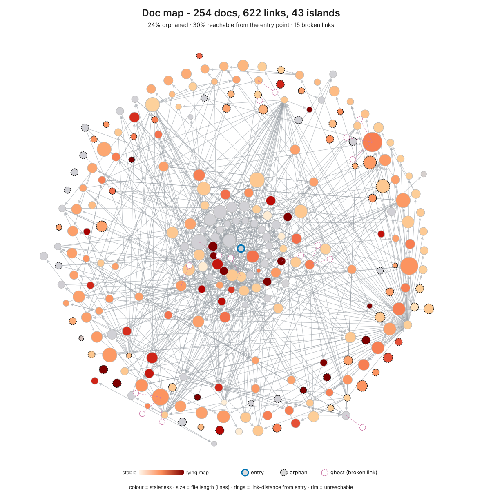
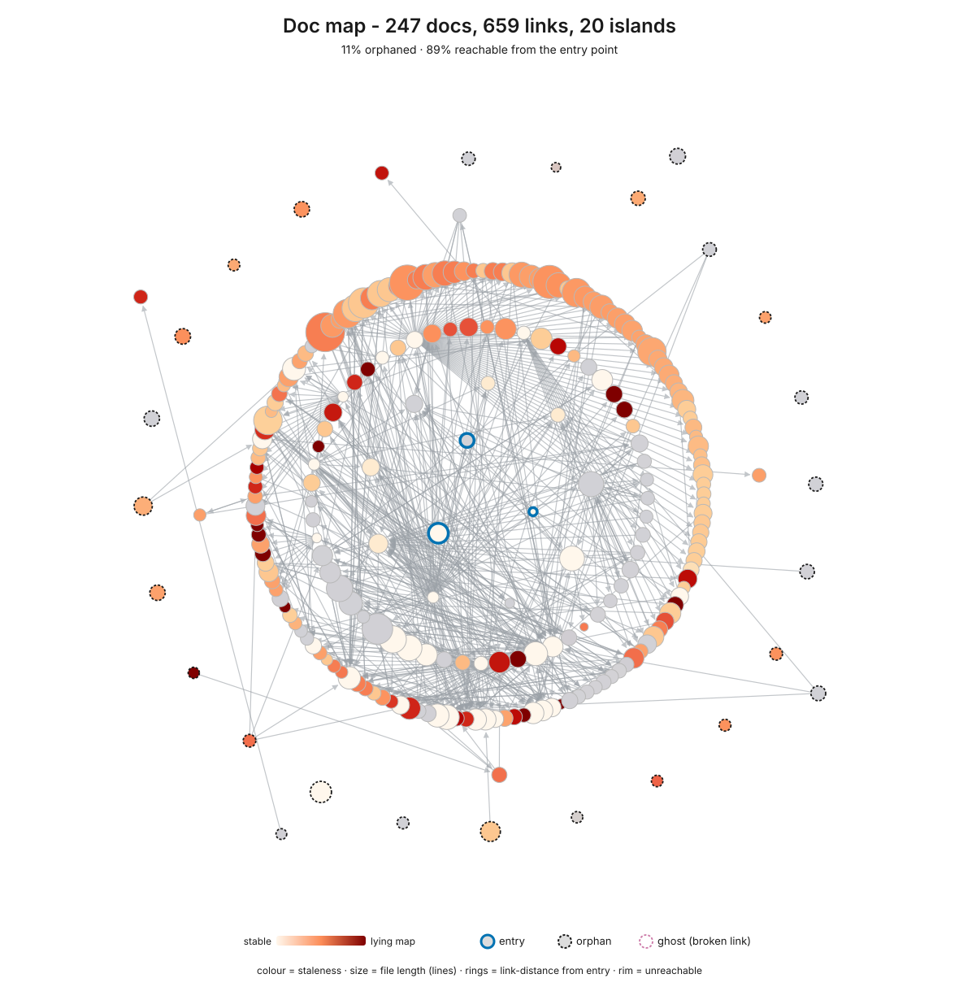
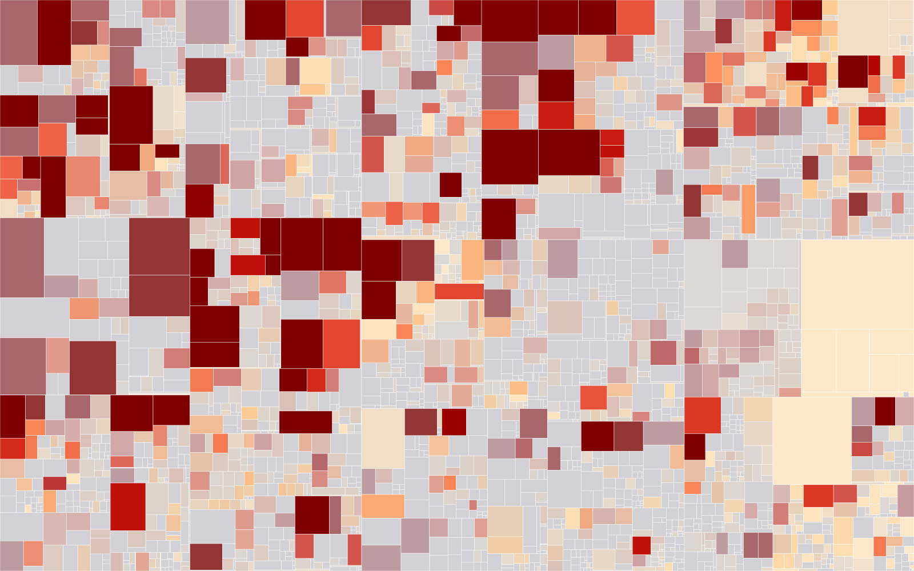
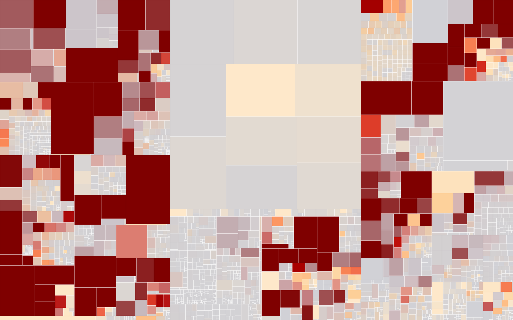
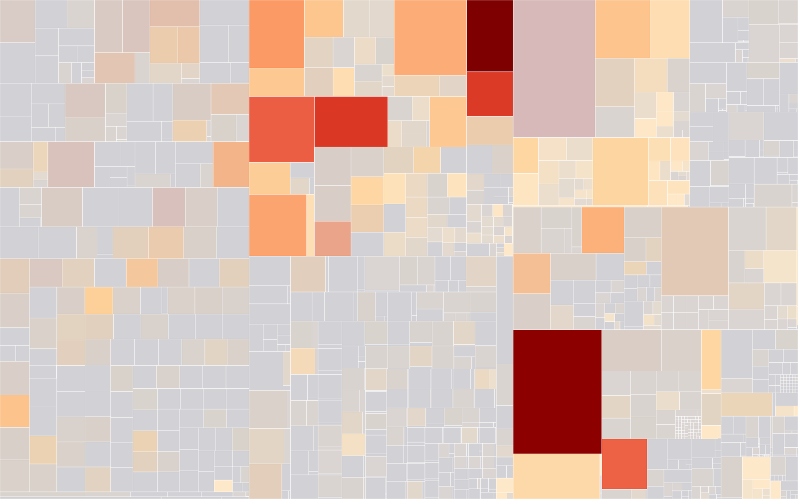
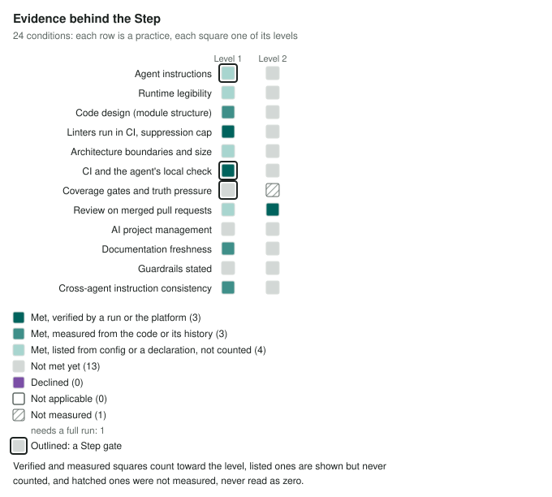
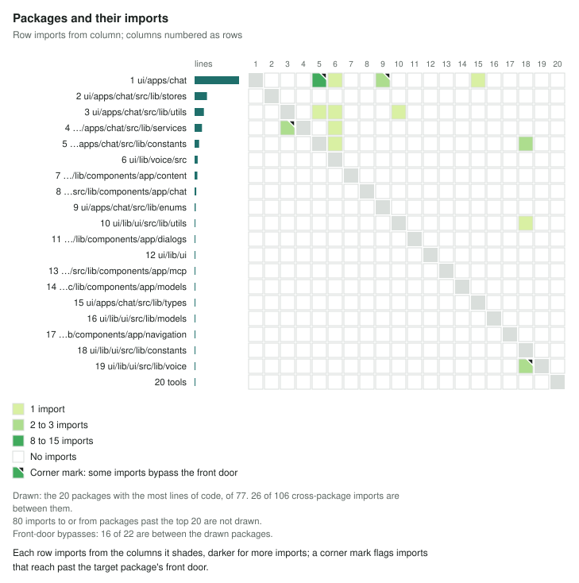
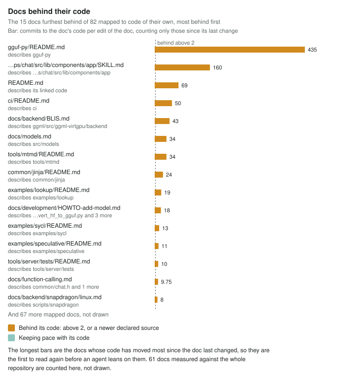
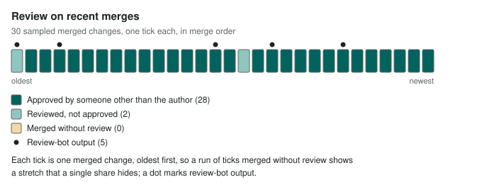

# AI Native Toolkit

[](.assess/assess-report.md) [](https://github.com/bjcoombs/ai-native-toolkit/actions/workflows/assess-gate.yml)

A Claude Code plugin - and a set of standalone skills for **any AI assistant**: skills and agents for AI-native development. In Claude Code it runs locally against your own codebase using whichever model you already pay for. Several of the skills also ship as standalone [Agent Skills](https://www.anthropic.com/news/skills) ZIPs you can upload to claude.ai, Claude Desktop, Cowork, or any assistant that supports the skills format - no Claude Code required.

> **Want the skills without Claude Code?** Download the ZIPs from the **[latest release](https://github.com/bjcoombs/ai-native-toolkit/releases/latest)** - the release notes link straight to that version's standalone skill bundle - and upload them in your assistant's Skills UI. Full walkthrough: [Standalone skill ZIPs](#standalone-skill-zips-any-ai-assistant). Currently standalone: `/assess`, `/huddle`, `/deslop`, `/skill-forge`, `/semantic-compress`.

> **Project site:** a one-page tour of the toolkit lives at https://bjcoombs.github.io/ai-native-toolkit/.

> **New here?** The [Map of Content](docs/index.md) is the navigation index - one trail to every skill, agent, and design doc in this repo. The [`CLAUDE.md`](CLAUDE.md) contract holds the rules for editing it.

> **Here from the GitHub Marketplace?** You found the **AI-Readiness Assess Gate** - the CI-gate half of this toolkit. It runs the same deterministic engine the `/assess` skill uses (complexity treemap, promissory-marker scan, doc-graph signals - zero AI tokens) on every pull request and gates on what your `.assess/config.toml` opts into. Jump straight to [Use as a GitHub Action](#use-as-a-github-action); the rest of this README covers the full plugin the action is carved from.

## Why this exists

When you hand work to an AI, does it behave like a brand-new hire, or like an engineer who has been in the org eighteen months? The difference isn't capability - both can write correct code. It's *externalized context*: knowing where things live, which contracts are load-bearing, where the minefields are, and why the weird thing is weird. An AI contributor is structurally always the new hire - every session starts with an empty head, seeing the codebase through one narrow context window. So the whole question becomes: **how much of the tenured engineer's implicit map has the codebase made explicit and navigable?** The more it has, the more a fresh agent behaves like it has been here eighteen months.

The aim is not an AI that comprehends complexity humans no longer can, trusted blindly - an agent fluent about code nobody can verify is the dangerous case, not the goal. The aim is a codebase legible enough that the *relevant slice* fits one context window, where the agent's answers stay anchored to code you can still check in ten seconds. **Legibility you can trust, not omniscience you can't.**

There's a second half, and it's the same ethic pointed the other way. When a contributor makes a mistake, the question is never "who do we blame" but "what made that mistake possible, and what would make it impossible next time?" A bank doesn't give a new engineer production access and hope - it builds role-based access, staged environments, and CI that catches the error before it ships. Those guardrails aren't distrust; they're how you protect people from costly mistakes by design, and an AI contributor needs the same protection a human does. `/assess` scores exactly these: linters, architecture tests, CI gates, coverage, review automation. Framed positively: **have we set the codebase up so that doing the wrong thing is hard, and the right thing is the path of least resistance?** Give the contributor the map *and* the guardrails - that is what `/assess` measures the distance to.

The headline pieces are five **skills**:

- **`/assess`** - measure how ready a codebase is for AI agent contributors. The maturity model is a list of conditions, each one checkable practice with file:line evidence and one or more truth tags naming what it keeps honest (behaviour, docs, structure, agent context and others). The deterministic headline leads with the autonomy **Step** the repo's contracts support, from 1 Assisted to 4 Autonomous loops, each Step past the first held by a named gate (an instruction file, CI that runs the tests, an enforced coverage gate) and by nothing else, and the gate that blocks the next Step. A Step never moves because the catalogue grew. Then comes "Catalogue coverage: N of M measured, V verified", which says how much of the catalogue the run could read, counting only conditions measured from the code or verified by a run or the platform; a condition the run could not see is shown with its reason and never counts as 0. It is never a progress figure. The run draws a Codecov-style complexity hotspot SVG and a doc-navigability graph SVG (both colour-blind-safe), plus an evidence waffle, a package map, a doc-drift map and a review strip, writes a report and opens a PR in the target repo.
- **`/huddle`** - structured multi-perspective deliberation using Six Thinking Hats with Fibonacci team sizing (solo -> debate -> huddle -> panel -> board). See it in action: a [narrated visual explainer](https://bjcoombs.github.io/ai-native-toolkit/huddle-explainer/visualization.html), and the [repeatable pipeline](./docs/huddle-explainer/README.md) used to build it.
- **`/deslop`** - detect and remove the telltale signs of AI writing (puffery, the rule of three, "not X but Y", filler diction, chatbot leakage, fabricated citations). Runs as a silent quality gate while writing, or as an explicit audit/edit pass. Derived from Wikipedia's "Signs of AI writing".
- **`/skill-forge`** - harden a skill (draft or existing) through judge-panel refinement rounds until it clears a strict 3-tier promotion gate. A prove-and-promote quality gate that runs after authoring, built on the same team-lead pattern as `/huddle` - and proven by forging itself.
- **`/semantic-compress`** - shrink an LLM-directed document (a prompt, instruction set, or skill) while preserving what it does: point at core knowledge the model already holds, keep project-specific detail verbatim, and - in Claude Code - gate whole-document distillation on an A/B behavioural-equivalence check so every cut is proven, not guessed. Includes a directive-clarity pass that rewrites latent-action instructions into ones that name the action.

Four more skills work across many repositories or across a doc set, and run in Claude Code only:

- **[`/ghsync`](skills/ghsync/SKILL.md)** - clone and keep in sync every non-archived, non-empty GitHub or GitLab repository you can access. Partial (`--partial`) and shallow (`--shallow-since`) clones for analysis-only mirrors, `--active-since` to skip dormant repositories, and `--porcelain-json` for per-repository metadata.
- **[`/ghreport`](skills/ghreport/SKILL.md)** - a read-only report of each repository's remote state (open PRs or merge requests, default-branch CI, security alerts, branch protection), plus org or group settings.
- **[`/fleet`](skills/fleet/SKILL.md)** - run the headless `/assess` signals across every repository under a `/ghsync` root or in a list, roll them up per group through a maturity model, keep a dated run history to compare against, and render a heat map SVG and per-team next-steps pages. No model in the gathering path.
- **[`/doc-contradictions`](skills/doc-contradictions/SKILL.md)** - find documents that contradict each other or the code they describe, with one read-only Haiku comparer per doc cluster and both sides of each finding cited as `path:line`.

## What `/assess` produces

Two paired SVG views from a single run, on a real ~650k-LOC monorepo (file paths sanitized). The first asks _can an agent find its way?_ The second asks _what's risky to change?_

Here is the same repo twice: an already-good AI-native codebase **before**, then the **same repo after** its maintainers worked through the Top 3 Actions from the `/assess` report. The story is that it gets measurably cleaner. Click any image for the full interactive SVG; hover any node or block for its underlying numbers.

<table>
  <tr>
    <th width="50%">Before</th>
    <th width="50%">After applying the Top 3 Actions</th>
  </tr>
  <tr>
    <td colspan="2" align="center"><b>Doc-navigability graph</b> - can an agent traverse the docs to the right place, and is what it finds still true?</td>
  </tr>
  <tr>
    <td><a href="docs/example-doc-graph.svg"></a></td>
    <td><a href="docs/example-doc-graph-after.svg"></a></td>
  </tr>
  <tr>
    <td colspan="2" align="center"><b>Complexity hotspot heatmap</b> - which files are riskiest to change next week?</td>
  </tr>
  <tr>
    <td><a href="docs/example-heatmap.svg"></a></td>
    <td><a href="docs/example-heatmap-after.svg"></a></td>
  </tr>
</table>

> **The measurable win.** In the doc-navigability graph, reachability from the entry point climbs from **30% to 89%**, orphaned docs fall from **24% to 11%**, disconnected islands drop from **43 to 20**, and the **15 broken links are gone**. The rim of orphans thins, the islands reconnect, and the lying-map reds cool - the map an agent consults before changing anything becomes honest. The heatmap stays the same repo's complexity profile throughout: it tells you which territory is dangerous, while the graph tells you whether the map is honest.

> **How to read them.** *Doc graph* - structure encodes reachability (centre = entry, rings = link-distance from entry, rim = unreachable, dashed ring = orphan, solid edge = link, dotted edge = reference); colour encodes staleness (vivid red = a frozen doc beside churning code, a *lying map*); size encodes file length. *Heatmap* - size encodes estimated tokens (~chars/4 - the keyhole size unit; the familiar LOC is one hover away in the tooltip), hue encodes cyclomatic complexity (red = high), saturation encodes recent git churn (vivid = active); the vivid-red blocks are the migration risk an agent (or human) is most likely to break next week. Both SVGs are colour-blind-safe (OrRd ramp, no red-green).

### The same lens, three real public repos

The pair above is this toolkit assessing a private monorepo. Below is `/assess` run unmodified against three public codebases in different languages, ordered by score. It is a calibration check: the layered model should discriminate between genuinely-engineered projects, not rubber-stamp the famous ones. Click any image for the full interactive SVG; hover any block for its numbers.

<table>
  <tr>
    <th width="33%"><a href="https://github.com/ktorio/ktor">ktor</a> (Kotlin)</th>
    <th width="33%"><a href="https://github.com/ggml-org/llama.cpp">llama.cpp</a> (C/C++)</th>
    <th width="33%"><a href="https://github.com/huggingface/candle">candle</a> (Rust)</th>
  </tr>
  <tr>
    <td><a href="docs/example-heatmap-ktor.svg"></a></td>
    <td><a href="docs/example-heatmap-llamacpp.svg"></a></td>
    <td><a href="docs/example-heatmap-candle.svg"></a></td>
  </tr>
</table>

> **What the spread shows.** Three real projects land three full points apart, so the model is reading enforcement, not reputation. `ktor` scores highest because it is the only one with all the write-side trust signals present - a CodeRabbit review bot, repo-wide `explicitApi()` type discipline, and a mandatory CI gate order - and its treemap stays calm (worst file ccn 141, against `llama.cpp`'s 4,123). `llama.cpp` pairs strong CI and type-checking with no coverage gates, no review bot, and no feedback loop; its `ggml-vulkan.cpp` is the textbook hotspot - cyclomatic complexity 4,123, a single function at 350, 14k LOC, 289 commits in a year - the large vivid-red block you cannot miss. `candle` is type-safe Rust with real CI but is missing both read-side layers (no committed `AGENTS.md`/`CLAUDE.md`, a fragmented doc graph), which caps how far its enforced write-side quality can carry the score. The lizard cyclomatic-complexity engine scored Rust and Kotlin directly here, not the scc keyword fallback. Point-in-time snapshot, June 2026, scored on the earlier 0-8 layer score that the Step and its gates have since replaced - these scores move as the projects do, which is the whole point.

### Four more views of one run: llama.cpp

`/assess` also draws four smaller diagrams beside the report. These four come from one run of the current toolkit against [`llama.cpp`](https://github.com/ggml-org/llama.cpp) at commit `1f8baae` (22 November 2026), the same public repo as the middle heatmap above. That run's headline is **Step 3, Unattended agent PRs**, with "Catalogue coverage: 6 of 14 measured, 3 verified" and one condition not measured. Click any image for the full SVG; hover any square, cell or tick for its numbers.

<table>
  <tr>
    <th width="50%">Evidence waffle</th>
    <th width="50%">Package map</th>
  </tr>
  <tr>
    <td><a href="docs/example-waffle.svg"></a></td>
    <td><a href="docs/example-package-map.svg"></a></td>
  </tr>
  <tr>
    <th width="50%">Doc-drift map</th>
    <th width="50%">Review strip</th>
  </tr>
  <tr>
    <td><a href="docs/example-doc-drift.svg"></a></td>
    <td><a href="docs/example-review-strip.svg"></a></td>
  </tr>
</table>

> **How to read them.** *Evidence waffle* - one square per condition of the maturity model, one row per model row; dark teal is met and verified by a run or the platform, mid teal met and measured from the code or its history, pale teal met but only listed from config or a declaration (shown, never counted), grey not met yet, whether it would count or only be listed (here 8 counted and 5 listed, so 6 met plus 8 grey make the "of 14"), and a hatched square was not measured, with its reason in the key. The verified and measured squares are the N in "Catalogue coverage". *Package map* - row imports from column, darker for more imports, with a lines-of-code bar beside each package and a corner mark where an import reaches past the target package's front door; it draws the 20 largest packages and states what it leaves out. The import graph builders read Python, Go, and TypeScript or JavaScript, so on llama.cpp, whose C and C++ they cannot read, the map shows its TypeScript web UI. *Doc-drift map* - one bar per doc with code of its own, its length the commits to that code per edit of the doc since the doc last changed; an amber bar is behind its code (past the dashed line at 2, or with a newer declared source), so `gguf-py/README.md` is the first doc to reread before an agent leans on it. *Review strip* - one tick per sampled merged change, oldest first, coloured approved, reviewed or merged without review, with a dot for review-bot output, so a run of unreviewed merges shows where a single share would hide it. The five dots are review-bot output the June snapshot above did not record.

### Why this matters for an AI-driven codebase

Once a codebase outgrows any single LLM context window and AI agents become regular contributors, code quality stops being a function of *who knows what* and starts being a function of *what the system enforces*. Norms ("we prefer X") fail because new contributors - especially AI agents starting each session fresh - never read them. Contracts ("the build fails if you don't do X") work because they're enforced regardless of who's reading.

`/assess` gives you paired views to act on that. The doc-navigability graph shows whether an agent can even find its way - how much of the docs is reachable, and which are stale maps of churning code. The complexity SVG shows where the codebase is today - which files will bite next week. The accompanying `assess-report.md` shows what scaffolding is in place to stop it getting worse: the Step and the gate that blocks the next one in its headline, then a scorecard that marks each of the layers below Present / Partial / Missing with concrete evidence.

### The intent: keep codebases comprehensible as AI accelerates them

The deeper problem `/assess` exists to address is not new — it is the oldest one in software maintenance: *what happens when the people who understood the code leave, or the code outruns anyone's ability to understand it?* The instinct when a system becomes incomprehensible is to throw it away and start again. That instinct was wrong in 2000 ([Joel Spolsky, *Things You Should Never Do*](https://www.joelonsoftware.com/2000/04/06/things-you-should-never-do-part-i/)) and it is wrong now, because a rewrite discards the undocumented behaviour and accumulated bug-fixes a working system has earned.

What AI changes is **velocity**. An agent can generate change faster than a team can keep comprehending it, so a codebase can slide from modern to legacy in *months* rather than years. The transition is the same; the clock is faster. That makes the discipline more important, not less.

So `/assess` is grounded in the accumulated practice of legacy-code engineering, and its reports name those anchors on purpose — they carry weight a reading agent recognizes:

- **"Legacy code is code without tests"** (Michael Feathers, *Working Effectively with Legacy Code*). A complex, churning, untested file is already legacy. The answer is **characterization tests** (pin actual behaviour) and **seams**, then incremental refactoring — Martin Fowler's **strangler fig**, never a big-bang rewrite.
- **Hotspots and change-coupling** (Adam Tornhill / CodeScene). The complexity-×-churn heatmap and coupling findings *are* the version-control-aware form of legacy comprehension — they tell an agent where the danger and the hidden seams actually are.
- **Decide per component** (the 7 Rs: retain, retire, rehost, replatform, refactor, re-architect, rebuild) rather than treating every flag as a refactor.

The goal is a codebase that stays legible to whoever — or whatever — works on it next: that its self-descriptions (docs, tests, types, instructions) are kept *honest under pressure*, not merely present. That honesty is what lets an agent (or a new hire) act without first having to rediscover the whole system.

The nine layers (0-8) are the report's scorecard and its reading order, not its score: the headline counts conditions, and its per-tag strip groups them by truth tag, not by layer. The layer numbers survive in the maturity model's row ids and as an alias that lets older configs and fleet history resolve. Read in order, the layers run from **read-side** (can the agent form a true picture?) through **write-side** (can it be trusted to produce good output?) to **meta** (does the system keep itself honest?). The full list of conditions, their grades and their tags is in [What /assess measures](docs/what-we-measure.md); the decisions behind the model are in the [scoring model](skills/assess/references/scoring-model.md).

| Layer | Band | What it enforces |
|-------|------|------------------|
| 0: Agent Instructions & Navigability | read | Compact rules in `CLAUDE.md` / `AGENTS.md` / `copilot-instructions`, plus a navigable doc graph (can an agent traverse links to the right place, and is what it finds still true?) |
| 1: Runtime Legibility / Liveness | read | Is the code actually live, and can the agent find out? Intra-repo dead-code signals + observability the agent can reach (logs/metrics/traces) |
| 2: Code Design | write | Compile-time correctness via types - dimensional types, generated API clients, exhaustive enums |
| 3: Linters | write | Style + correctness with rules targeting AI failure modes (suppressions, complexity gates, leftover TODOs) |
| 4: Architecture Tests | write | Structural rules as executable tests (`depguard`, ArchUnit-style boundary checks) |
| 5: CI Pipeline | write | Every PR runs everything; failing pipeline blocks merge |
| 6: Coverage Gates | write | Test discipline as a build contract |
| 7: Review Bots | write | Design-level feedback (CodeRabbit, claude[bot]) catching what linters can't |
| 8: AI Project Management | meta | Retros, task tracking, the feedback loop that keeps the contracts above current |

The Layer 0 navigability model - treating the docs as a link graph an agent must traverse - adapts the **"Lint"** health-check from [Andrej Karpathy's LLM-wiki pattern](https://gist.github.com/karpathy/442a6bf555914893e9891c11519de94f) (hubs, orphans, connectivity, an `index.md` catalog and `log.md`), making its *structural* checks deterministic. The semantic ones it also lists stay out of the deterministic core: contradictions between pages are what [`/doc-contradictions`](skills/doc-contradictions/SKILL.md) looks for, and concepts lacking a page are not checked.

The report's headline leads with the **Step**: how much agent autonomy the repo's contracts support, on the adoption ladder from [Boris Cherny's *Steps of AI Adoption*](https://www.threads.com/@boris_cherny/post/Da4CkQnEea-) (July 2026) - 1 Assisted, 2 Supervised agent PRs, 3 Unattended agent PRs, 4 Autonomous loops - with the gate that blocks the next Step, then "Catalogue coverage: N of M measured, V verified" with the maturity-model version, then a strip of the same counts per truth tag. A Step needs its gates and nothing else, so no count moves it; the coverage line says how much of the catalogue the run could read. All three are computed deterministically from the commit, never by the model. The Steps work because Cherny's per-step guardrails are these layers seen from the org side (self-verification loops = L5/L6, automated review = L7, agent instructions = L0, encoded permissions/routines = L8): the Step bounds how far up his ladder a team can safely operate this repo, without claiming anything about how the team actually works. Layer 8's `agent_ops` signals (committed permission allowlists, hooks, sandbox rules, routine definitions) score the repo-observable subset of those guardrails.

**Traditional tooling, applied to an AI-era question.** The assessment itself runs on conventional static analysis - `lizard`/`scc`, git history, and graph metrics over the docs and code - not the model. The LLM only writes the prose around the numbers. So a full run is fast and spends almost no model tokens, and the structural findings are reproducible run-to-run.

A codebase can hold Step 4 and still be on fire (strong contracts, legacy debt) or Step 1 with a calm treemap (small codebase, no enforcement needed yet). The headline tells you whether the system will catch the next class of pain before it lands; the SVG tells you where today's pain already is. The report's **Top 3 Actions** table names specific files, always - "improve code quality" is the failure mode `/assess` exists to prevent; "Add `cyclop` rule (threshold 15) to `.golangci.yml`. Current p95 ccn is 23; immediate offenders: `internal/import/parser.go` (ccn 67)" is what makes the report actionable.

**The compounding payoff.** Contracts are front-loaded - types, lint rules, architecture tests, agent instructions all take time to write. The payoff compounds: every new service, feature, and contributor inherits the contracts that already exist. Skip them and you lose 15-45 minutes per AI session to convention drift, rework, and false signals - forever. Run `/assess` periodically to ratchet the practices in place upward; each layer you add closes a recurring cost.

A stats sidecar (`complexity-stats.json`) accompanies the report with percentiles and ranked file lists that feed the treemap and the report's hotspot callouts.

### What else the deterministic core checks

The per-module detail is in each module's docstring under [`skills/assess/scripts/lib/`](skills/assess/scripts/lib/README.md). Among the checks and behaviours there:

- **Scan registry.** Every run-context block is declared once in `scan_registry.py`. A scan that cannot run (no remote, no `gh`, an unreadable endpoint) reports itself as unavailable with a reason instead of stopping the run.
- **Headless signals.** `assess_signals.py` runs the scans with no model and writes one JSON document ([schema](skills/assess/references/signals.schema.json)). With `--counts-only` it keeps numbers and a fixed list of path and token fields and drops all other text ([field list](skills/assess/references/counts-only.md)); `--hash-paths` replaces paths with salted hashes. `/fleet` is built on this entry point.
- **GitLab remotes.** Through `glab`, review reality and configuration drift read GitLab merge requests and protected branches, as they read GitHub through `gh`.
- **Instruction files.** The `instruction_placement` scan names sections of an always-loaded instruction file that belong elsewhere, and the instruction grade counts always-on lines past 200 and lines that belong elsewhere. Checkable claims an instruction file makes, such as a script being enforced in CI, are verified against the repository; `doc_claims` runs the same checks over the wider doc set and adds a cross-document kind.
- **History honesty.** Churn follows renames, so a renamed file keeps its history. On a shallow clone, the doc-staleness clock and the accretion signal mark their results as truncated or unreliable instead of reading the cut-off history as real.
- **Tests.** `.bats` files count as tests for shell scripts.
- **Method versioning.** Each run writes `.assess/findings.json` with the finding method version and every finding's paths. When a later toolkit release changes how findings are decided, the CI gate compares that committed snapshot (the `findings.json` on disk, even when no pipeline has run since it was committed) with its own run. It names the method change, lists the findings that appeared and cleared by path, and prints the re-freeze command. Those moves also carry any code changed since the snapshot was committed, so they are not attributed to the method alone. When the gate's pinned toolkit is older than the snapshot's, it says to raise the pin instead.
- **Repositories you do not maintain.** On a read-only target that takes contributions, the end-of-run offer files the Top 3 Actions as issues upstream, each linking the full report hosted in your fork.

### Build artifacts and generated code are filtered by default

A single `main.dart.js` or thousands of lines of `.pb.go` shouldn't dominate the treemap. The filter catches minified bundles (`*.min.js`, `*.bundle.js`, `main.dart.js`), sourcemaps, protobuf bindings (`*.pb.go`, `*.connect.go`, `*_pb.ts`), Go generators (`wire_gen.go`, `zz_generated_*.go`), .NET source generators (`*.designer.cs`, `*.g.cs`), Dart codegen (`*.freezed.dart`, `*.g.dart`), `*.generated.*` and `database.types.ts`, files whose first 5 lines declare them generated (`DO NOT EDIT`, `@generated`), payload files whose average line exceeds 1,000 characters, and files under build dirs (`dist/`, `build/`, `.next/`, `.nuxt/`, `node_modules/`, etc.). Pass `--include-artifacts` to disable. If a single file still holds >30% of total LOC after filtering, the script warns - usually that's a build artifact that needs `.gitignore`.

The skill runs locally - lizard, optional scc, and git log do the analysis in your Claude Code session. No data leaves the machine, with one bounded exception: when the repo has a github.com remote, the scan makes read-only GitHub API calls through your own authenticated `gh`, sending the repo name (plus ruleset ids and branch names when the repo tracks ruleset or branch-protection snapshots). It counts the pull requests merged in the last 30 days, to estimate the CI gate's Actions minutes, compares tracked snapshots with the live settings, and reads the 30 most recently opened merged pull requests and the default branch's review rules to measure whether merged changes were reviewed, keeping counts and shares only (no titles or user names); each reports as unavailable when `gh` is missing or signed out.

### Use as a GitHub Action

The assess gate ships as a composite GitHub Action ([Marketplace listing](https://github.com/marketplace/actions/ai-readiness-assess-gate)), so any repo can run the deterministic core on every PR without installing the plugin - no Claude, no API keys, no tokens spent:

```yaml
steps:
  - uses: actions/checkout@3d3c42e5aac5ba805825da76410c181273ba90b1  # v7.0.1
    with:
      fetch-depth: 0   # full history so the churn window is accurate
  - uses: bjcoombs/ai-native-toolkit@v1.92.0
    with:
      config: .assess/config.toml   # optional; warn-only defaults without it
```

Two badges come with it - GitHub's native status badge for the gate workflow, and a live AI-readiness badge served from the committed `.assess/badge.json` via shields.io (written by every assess run: the Step and the next gate, e.g. `Step 3 · next: coverage gate`, or `Step 4 · all gates held`):

```markdown
[](https://github.com/<owner>/<repo>/actions/workflows/assess-gate.yml)

```

Warn-only by default: the only thing that can fail a PR is what `.assess/config.toml` opts into (`fail_on` findings, complexity floors, `fail_on_regression`). Because the version rides a `uses:` pin on an immutable release tag, **Dependabot and Renovate detect new toolkit releases and open upgrade PRs automatically** - add a `.github/dependabot.yml` with the `github-actions` ecosystem and the gate keeps itself current. The `/assess` end-of-run "freeze into CI" offer emits this workflow, with actions pinned to commit SHAs and the toolkit pinned to the newest published tag.

> **Portability split.** The framework pieces (`/assess`, `/huddle`, `/deslop`, `/skill-forge`, `/semantic-compress`, `/ghsync`, `/ghreport`, `/fleet`, `/doc-contradictions`, `/6hats`, `/understand` and their agents) are portable and work in any Claude Code session (`/fleet`'s `ROOT` mode reads the `<repo>-main` + `worktree/` layout that `/ghsync` creates). The workflow commands (`/tm`, `/issues`, `/fix-pr`, `/fix-develop`) bake in one author's daily setup: a `<repo>-main/` + `worktree/` layout, GitHub + `gh` CLI, Task Master, CodeRabbit/claude[bot] review threads, and the Agent Teams capability flag. See [Adapting](#adapting-for-your-workflow) before relying on them in a different setup.

## Install

From inside a Claude Code session (not a shell - `/plugin` is a Claude Code command):

```text
/plugin marketplace add https://github.com/bjcoombs/ai-native-toolkit
/plugin install ai-native-toolkit@ai-native-toolkit
```

Skills appear namespaced: `/ai-native-toolkit:assess`, `/ai-native-toolkit:fleet`, `/ai-native-toolkit:doc-contradictions`, and so on. Update with `/plugin update ai-native-toolkit`. Remove with `/plugin remove ai-native-toolkit`. The plugin doesn't touch your existing `~/.claude/` files.

**On Windows**, the [Windows setup guide](docs/windows.md) covers the baseline (Git for Windows with Git Bash, Python 3.11+, uv optional), installing rg, jq, gh and glab, PATH notes, and the commands to run in place of `make`.

## Standalone skill ZIPs (any AI assistant)

`/assess`, `/huddle`, `/deslop`, `/skill-forge`, and `/semantic-compress` ship as standalone [Agent Skills](https://www.anthropic.com/news/skills) ZIPs - **no Claude Code required**. They are plain skill folders (a `SKILL.md` plus reference files), so they work in any assistant that supports the skills format. Verified in claude.ai web, Claude Desktop, and Cowork; usable anywhere the format is accepted. Each ZIP is fully self-contained - download just the skill you want.

### Two install paths - pick by where you work

| You use... | Install via | Updates |
|---|---|---|
| Claude Code | `/plugin install` (see [Install](#install) above) | Automatic on `/plugin update`. Use this when available - it's the maintained path. |
| claude.ai, Claude Desktop, Cowork, or any other AI assistant | Manual ZIP upload (below) | Manual: re-download from the latest release and use the Skills UI's **Replace** option. See [Upgrading the standalone install](#upgrading-the-standalone-install) and [Staying notified of new versions](#staying-notified-of-new-versions) below. |

The ZIPs are rebuilt automatically from the same source on every plugin version bump, so feature parity is maintained - only the update mechanism differs.

### Prerequisites for the ZIP path

- A paid plan (Pro, Max, Team, or Enterprise) - Skills upload is not on the Free tier.
- For `/assess`: **Settings → Capabilities → Code execution and file creation** must be on (required for the Python scripts). Enable **Allow network egress** too if your repo's `pyproject.toml` pulls dependencies.
- `/huddle`, `/deslop`, `/skill-forge`, and `/semantic-compress` need neither - they're pure reasoning.

### Install (claude.ai web - verified path)

1. Open the **[latest release](https://github.com/bjcoombs/ai-native-toolkit/releases/latest)**. Its release notes link to that version's **standalone skill ZIPs** bundle (a fresh bundle is published on every plugin version bump). From there, download the skill(s) you want - `assess.zip`, `huddle.zip`, `deslop.zip`, `skill-forge.zip`, `semantic-compress.zip`. Each ZIP is self-contained, so grab only the ones you need.
2. Open https://claude.ai/customize/skills (or sidebar → Customize → Skills).
3. Click the **+** at the top right of the Skills column.
4. Hover **Create skill →** then click **Upload a skill**.
5. Select the `.zip` (don't unzip).
6. Confirm the skill appears under **Personal skills** with toggle on and **Trigger: Slash command + auto**.

Claude Desktop, Cowork, and other assistants expose the same Skills uploader (usually under Settings); the flow is analogous.

### Upgrading the standalone install

The Skills UI has a built-in **Replace** option - use it instead of uninstalling and re-uploading (Replace preserves any in-progress chats that reference the skill).

1. Download the new ZIP for the skill you're upgrading from the [latest release](https://github.com/bjcoombs/ai-native-toolkit/releases/latest) (follow the standalone skill ZIPs link in its notes).
2. In Customize → Skills, click the skill you want to upgrade.
3. Open the three-dot menu (⋮) in the top right of the detail pane.
4. Click **Replace** and select the new `.zip`.
5. The toggle and trigger settings persist; only the skill contents change.

**Checking which version you have installed.** The skill's Description field in the Skills UI ends with `Standalone build vX.Y.Z` - that's the version that shipped in the ZIP you uploaded. Compare against the [latest release](https://github.com/bjcoombs/ai-native-toolkit/releases/latest) to know if there's a newer one.

### Staying notified of new versions

Neither Claude Desktop nor claude.ai polls for skill updates - the platform has no notification mechanism for uploaded skills. Two opt-in ways to hear about new releases:

- **GitHub Watch.** On the [repo page](https://github.com/bjcoombs/ai-native-toolkit), click **Watch → Custom → Releases**. You'll get an email (and a GitHub notification) whenever a new tag ships.
- **Atom/RSS feed.** Subscribe to https://github.com/bjcoombs/ai-native-toolkit/releases.atom in any RSS reader (Reeder, Feedly, NetNewsWire, etc.).

Plugin-install users get this for free via `/plugin update ai-native-toolkit` - no subscription needed.

### Verify the auto-trigger works

In a fresh chat, try:

- **assess**: "How AI-ready is this codebase?" / "Give me a complexity heatmap"
- **huddle**: "Run a huddle on [decision]" / "Give me red-team/blue-team analysis of [question]"
- **deslop**: "Make this sound less like AI" / "De-slop this draft" / "Does this read as AI-written?"
- **skill-forge**: "Harden this skill" / "Is this skill ready to ship?"
- **semantic-compress**: "Compress this prompt without losing meaning" / "Tighten this instruction set"

If a skill only fires on `/skill-name` and not on natural language, the frontmatter description is missing trigger phrasing - edit `standalone_description` in `scripts/standalone_skill_config.py` and rebuild.

### Capability differences vs Claude Code

- `/huddle` runs in solo or phased sub-agent mode here - Claude reasons through each hat phase directly. Team mode (persistent agents with cross-talk) requires Claude Code.
- `/assess` runs the full layered assessment. The SVG treemap and deterministic wiki need terminal access to the bundled scripts.

## Try it

### Assess a codebase

```text
/ai-native-toolkit:assess
```

Runs against the current directory (or pass a path). Produces:

- `.assess/assess-report.md` - the Step and verified-practices headline, per-layer scorecard, top 3 leverage actions, hotspot callouts
- `.assess/doc-graph.svg` - the doc-navigability graph shown above
- `.assess/complexity-heatmap.svg` - the complexity treemap shown above
- `.assess/evidence-waffle.svg` - one square per maturity-model condition, showing how much of the level rests on verified or measured evidence
- `.assess/package-map.svg` - the 20 largest packages as an import matrix, with the imports that bypass a package's front door outlined
- `.assess/doc-drift.svg` - the 15 docs furthest behind the code they describe, as ranked bars
- `.assess/review-strip.svg` - one tick per recently merged change: approved, reviewed or merged without review, in merge order
- `.assess/complexity-stats.json` - percentiles and ranked file lists that feed the report

After writing, the skill asks whether to open a PR in the target repo with the report and its SVGs.

### Run a huddle on a hard decision

```text
/ai-native-toolkit:huddle Should we migrate the monolith to microservices?
```

Spawns a Fibonacci-sized team (default 3) that cycles through De Bono's six hats - facts, feelings, risks, benefits, alternatives, synthesis - and returns a structured recommendation. Use `/6hats <q>` for a faster solo variant.

### Measure a fleet of repositories

```text
/ai-native-toolkit:ghsync --org my-org --root ~/dev/github.com/my-org --partial
/ai-native-toolkit:fleet ~/dev/github.com/my-org --out fleet-out
```

`/ghsync` mirrors the org into `--root`, which must already exist; `/fleet` runs the headless `/assess` signals on each checkout and writes `repos.jsonl` (one counts-only line per repository), `groups.jsonl` and `run.json` to `fleet-out/`. See [`skills/fleet/SKILL.md`](skills/fleet/SKILL.md) for the maturity-model roll-up, `--compare`, `--delete-after`, the heat map and the next-steps pages.

### Check the docs for contradictions

```text
/ai-native-toolkit:doc-contradictions
```

Writes `.doc-contradictions/report.md` in the current repository: one entry per contradiction, both sides cited as `path:line`, each with a confidence. It never edits a document or source file.

## What's in the box

### Skills (auto-discovered by Claude Code)

Full catalog and per-skill base docs: [`skills/README.md`](skills/README.md).

| Skill | Description |
|-------|-------------|
| [`/assess`](skills/assess/SKILL.md) | Layered AI-readiness assessment (0-8 contract model) plus a Codecov-style complexity hotspot SVG and a doc-navigability graph SVG (both colour-blind-safe). Ships [`complexity-treemap.py`](skills/assess/scripts/complexity-treemap.py) and [`doc-graph-svg.py`](skills/assess/scripts/doc-graph-svg.py) so the agent runs them with no external setup. Filters build artifacts and generated code by default (opt-out with `--include-artifacts`); warns when one file dominates LOC. Offers to install optional `scc` for repos heavy in markdown/JSON/YAML. Generated PRs include a self-install footer so reviewers can adopt the plugin. |
| [`/huddle`](skills/huddle/SKILL.md) | Multi-perspective deliberation using Six Thinking Hats with Fibonacci team sizing (solo -> debate -> huddle -> panel -> board). Three execution modes: solo flat-parallel, phased sub-agent (default fallback), and team mode (needs Agent Teams capability flag). |
| [`/deslop`](skills/deslop/SKILL.md) | Detect and remove the telltale signs of AI writing - puffery, the rule of three, "not X but Y", filler diction, chatbot leakage, fabricated citations. Two modes: a silent quality gate while writing prose, or an explicit de-slop/audit pass. Ships a [`references/full-checklist.md`](skills/deslop/references/full-checklist.md) A-F catalog derived from Wikipedia's "Signs of AI writing" (revision of 15 November 2026) - the skill flags itself for re-derivation if it goes stale, since the tells drift with model generations. |
| [`/ghsync`](skills/ghsync/SKILL.md) | Bulk clone and keep in sync every GitHub or GitLab repo you can access, skipping archived and empty ones - built for onboarding into a new enterprise. On GitLab (`--provider gitlab --host <host>`), covers every group you belong to with nested subgroups and shared projects, laid out by `path_with_namespace`; `--porcelain` plus `--from-list` split discovery from cloning for hosts reachable only from another network. For an org, unions the repos reachable through your teams with the org's repo list (so direct-collaborator and public repos count); for a personal account, uses the account's repo list. Deduplicates, then clones new ones and fast-forward syncs existing checkouts and their worktrees into a `<repo>/<repo>-main` + `<repo>/worktree` layout. Org defaults to the directory you run from. Never clobbers local work (uncommitted or off-default-branch repos are fetched, not pulled) and reports every exception in a summary. For analysis-only mirrors, `--partial` (`--filter blob:none`) and `--shallow-since DATE` shape new clones; `--active-since DURATION` keeps only repositories with a recent default-branch commit, and `--porcelain-json` prints one JSON object of metadata per repository instead of cloning. Ships [`ghsync.sh`](skills/ghsync/scripts/ghsync.sh); needs `gh` + `jq` (or `glab` + `jq` for GitLab), supports GitHub Enterprise via `GH_HOST`. |
| [`/ghreport`](skills/ghreport/SKILL.md) | Read-only org repo state report for GitHub or GitLab. Reuses `/ghsync`'s repo discovery but, instead of cloning, queries each repo's remote state - on GitHub open PRs, CI on the default branch, open security alerts (Dependabot / code-scanning / secret-scanning), and branch protection; on GitLab (`--provider gitlab --host <host>`, optionally `--group <path>`) open merge requests, the latest default-branch pipeline, open vulnerabilities and default-branch protection - and rolls it into a terminal summary plus a timestamped markdown file. Endpoints the token or tier cannot read are reported as no-access / unknown, never as a clean zero. After the per-repo table, an org or group settings section reports two-factor enforcement, push rules, default-branch protection and rulesets. Needs `gh` + `jq` (or `glab` + `jq` for GitLab). |
| [`/fleet`](skills/fleet/SKILL.md) | Runs the headless `/assess` signals (`assess_signals.py`) across every repository under a `/ghsync` root or in a `--from-list` file, each in its own process from a worker pool, and writes one counts-only JSON line per repository to `repos.jsonl` (schema: [`repos.schema.json`](skills/fleet/references/repos.schema.json)). It then rolls the rows up to one line per group in `groups.jsonl` (schema: [`groups.schema.json`](skills/fleet/references/groups.schema.json)): repository counts, distinct shared CI sources and marketplaces, the `ghreport` group settings passed with `--settings`, and each `--levels` maturity-model row's whole level (or `unknown`) with its aggregation rule. `fleet_next_steps.py` renders one Markdown page per group from that output: each row's level, the next level's unmet criteria as single-change steps with repository-native "done when" checks, and the repositories holding the group back. `heatmap.py` renders that run as a leadership heat map SVG (groups by maturity-model rows, ColorBrewer OrRd, `unknown` hatched apart from level 0 with the missing signal named, change against an earlier run with `--compare`). Each counts-only run is kept in a dated run history, so `--compare` can show what moved since the last run; `--delete-after` deletes each clone once it is scanned to keep disk use flat. Deterministic (two runs over unchanged checkouts on the same day are byte-identical, except with `--hash-paths` and no `--hash-salt`), never writes to a target, and a repository that cannot be scanned becomes a `failed` row with a reason token instead of stopping the run. No model in the path. Optional `--label` step: a Haiku subagent labels each repository from its row (`service`, `library`, `infrastructure`, `mirror`, `docs`, `other`) into a separate `labels.jsonl` ([schema](skills/fleet/references/labels.schema.json)), display and filter only, never scored. |
| [`/doc-contradictions`](skills/doc-contradictions/SKILL.md) | Find documents that contradict each other or the code they describe. Clusters the doc set by the doc graph and shared subject code, fans out one read-only Haiku comparer per cluster plus a cross-cluster pass over hub docs, and writes a Markdown report: one entry per contradiction, both sides cited as `path:line`, with a confidence. Historical intent records (`docs/design/`, `docs/superpowers/`) are excluded by default. Plugin-only (needs subagents). |
| [`/semantic-compress`](skills/semantic-compress/SKILL.md) | Optimize an LLM-directed document while preserving what it does, gated on the `ab-equivalence` library skill's A/B harness. Two transforms in one optimizer family: **compress** (a local core->pointer pass plus an A/B-validated distill loop producing the smallest behaviourally-equivalent document) and **directive-clarity** (rewrites latent-action instructions - bare negations, facts-not-actions, vague pointers - into directives that name the action, validated by a measured directness gain at zero regression). Both rest on a [cognitive-ergonomics](skills/semantic-compress/references/cognitive-ergonomics.md) frame whose claims are hypotheses the harness measures, never asserts. |
| [`/skill-forge`](skills/skill-forge/SKILL.md) | Harden a skill or agent instruction file (`CLAUDE.md`, `AGENTS.md`, ...) through judge-panel refinement rounds until it clears a 3-tier promotion gate, then promote it. |

Also auto-discovered, but not invoked directly: the library skills `marathon`, `pr-review-merge` and `ab-equivalence`, and the `/assess` render-time helpers `assess-findings` and `assess-pr`.

### User-invoked skills (slash-command only)

These set `disable-model-invocation: true`: Claude runs one only when you type it, never on its own. Full catalog: [`skills/README.md`](skills/README.md#user-invoked).

Portable:

| Skill | Description |
|---------|-------------|
| [`/6hats <question>`](skills/6hats/SKILL.md) | Solo Six Hats analysis - alias for `/huddle` at team size 1 |
| [`/understand <thing>`](skills/understand/SKILL.md) | Deep understanding mode (nemawashi) - exhaustive context-gathering before action |

Workflow (personal setup, opt-in - see [Adapting](#adapting-for-your-workflow)):

| Skill | Description |
|---------|-------------|
| [`/tm`](skills/tm/SKILL.md) | Task Master orchestration - context-aware: starts, reviews, or cleans up tasks based on current state |
| [`/issues`](skills/issues/SKILL.md) | GitHub-issue marathon - triage open issues (tag `agent-ready` or post clarifying questions), then run agent-ready ones to merge with Agent Teams; mirrors `/tm`'s plan-then-marathon flow |
| [`/tm-marathon-config-example`](skills/tm-marathon-config-example/SKILL.md) | Reference configuration block to drop into a project's `CLAUDE.md` for marathon-mode `/tm` and `/issues` |
| [`/fix-pr`](skills/fix-pr/SKILL.md) | Autonomous PR fixing loop - iterates on CI failures and review comments until green |
| [`/fix-develop`](skills/fix-develop/SKILL.md) | Autonomous fix loop for failing CI on the repo's default branch |

`/tm` and `/issues` share the `marathon` skill (team orchestration engine: DAG analysis, waves, crash recovery, retrospective); all four workflow skills share the `pr-review-merge` skill (review-to-green loop + smart merge) as a single source of truth. Each workflow supplies a thin work-source adapter; the skills own the execution.

### Agents (invoked by skills, or directly via `Agent(subagent_type=...)`)

Full catalog: [Map of Content, Agents](docs/index.md#agents).

The Six Hats team that `/huddle` and `/6hats` orchestrate:

| Agent | Role |
|-------|------|
| `white-hat` | Facts and evidence |
| `red-hat` | Gut feelings and emotional drivers |
| `black-hat` | Risks and critical analysis |
| `yellow-hat` | Benefits and opportunities |
| `green-hat` | Creative alternatives |
| `blue-hat` | Synthesis and recommendation |
| `scribe` | Structures hat output into actionable documentation |

`assess-layer-scorer` scores a codebase against the `/assess` 0-8 layered model from `run-context.json`, Present/Partial/Missing per layer with evidence (used by `/assess`).

## Why Six Hats?

A blind spot detector for high-stakes decisions, based on Edward de Bono's method.

**Cost:** 5-10x the tokens of a single prompt. Six parallel agents plus synthesis adds up.

**Benefit:** Catches the question you didn't know to ask. Black Hat might reveal your "performance optimization" is really about deployment fear. Green Hat might find the lazy solution that actually works.

**Real example:** an earlier draft of this README was reviewed via `/6hats review please`. Black Hat called it "a 13-point solution to a 2-point problem" with "rigged comparisons" and "zero evidence." That critique led to a rewrite. A single prompt wouldn't have been that harsh.

**Use it for:** architecture decisions you can't easily reverse, "should we..." questions where you suspect you're asking the wrong question, decisions where being wrong costs 100x more than the analysis, when you want pushback rather than validation.

**Skip it for:** routine decisions, debugging, implementation details, anything you can reverse. For those, a single well-crafted prompt is enough:

```text
Help me decide [X]. Be opinionated. If this is a bad idea, say so directly.
What am I not considering? What's the lazy solution that might work?
```

## Adapting for your workflow

The framework pieces (`/assess`, `/huddle`, `/deslop`, `/skill-forge`, `/semantic-compress`, `/ghsync`, `/ghreport`, `/fleet`, `/doc-contradictions`, `/6hats`, `/understand` and their agents) are reusable as-is. `/ghsync` creates the `<repo>/<repo>-main` + `worktree/` layout itself, and `/fleet`'s `ROOT` mode reads that layout (or takes a `--from-list` file), so neither needs adapting by hand. The workflow skills embed assumptions you will likely need to override:

- **Directory layout** - `skills/tm/SKILL.md`, `skills/issues/SKILL.md`, `skills/fix-pr/SKILL.md`, `skills/fix-develop/SKILL.md` all assume `~/dev/github.com/<org>/<repo>/<repo>-main/` + sibling `worktree/`. Edit the path patterns to match your structure.
- **Default branch** - `/fix-develop` derives the branch via `gh repo view --json defaultBranchRef`. `/tm` uses a `$BASE_BRANCH` variable. Other workflow skills may still reference `develop` in prose; check before relying on them on a `main`-default repo.
- **Required external tools** - `gh` CLI for GitHub, [Task Master](https://github.com/eyaltoledano/claude-task-master) for `/tm`, optional Agent Teams capability flag (`$CLAUDE_CODE_EXPERIMENTAL_AGENT_TEAMS`) for `/tm` marathon mode.
- **Review-bot conventions** - PR-loop logic in `/tm`, `/fix-pr`, `/fix-develop` distinguishes CodeRabbit, claude[bot], and human threads. Adjust if your repo uses different bots.
- **CLAUDE.md** - your global / project `CLAUDE.md` references to the directory structure need to match.

### Git workflow assumed by `/tm`, `/issues`, `/fix-pr`, `/fix-develop`

```text
~/dev/github.com/<org>/<repo>/
├── <repo>-main/                    # SACRED - always on default branch, never modified
└── worktree/
    ├── <tag>/                      # Task Master tag folder (nested)
    │   ├── 1--create-schema/       # Task worktree
    │   └── 2--add-api/             # Another task worktree
    └── fix-login-bug/              # Non-TM worktree (flat)
```

The key principle: **never work directly on the default branch**. `<repo>-main/` stays on `develop`/`main` and clean; all work happens in worktrees. The `/tm` command handles worktree creation and cleanup automatically. To create one by hand:

```bash
cd ~/dev/github.com/<org>/<repo>/<repo>-main
git checkout develop && git pull origin develop
git branch fix-login-bug
git worktree add ../worktree/fix-login-bug fix-login-bug
cd ../worktree/fix-login-bug
# work, commit, push, create PR
```

## Repository structure

```text
ai-native-toolkit/
├── README.md
├── CLAUDE.md                          # Contract for agents editing this repo
├── FLOOR.md                           # Constitutional floor of the acceptance-contract workflow
├── .file-size-ratchet.toml            # Line limits for Python files: 800 by default, recorded ceilings for larger files
├── action.yml                         # AI-Readiness Assess Gate composite action
├── Makefile                           # make setup (locked uv environments), make check (the required CI checks)
├── .claude-plugin/
│   ├── plugin.json                    # Plugin manifest (enables /plugin install)
│   └── marketplace.json               # Marketplace entry (enables /plugin marketplace add)
├── .github/workflows/                 # assess-gate, build-standalone-skills, claude-review, codeql, floor, mutation, pr-lint, tests
├── .assess/                           # This repo's own /assess wiki (report, heatmap, hotspots, log)
├── skills/                            # One directory per skill - catalog in skills/README.md
│   ├── assess/                        # SKILL.md, scripts/ (assess_core.py, lib/, renderers), references/, templates/, tests/
│   ├── assess-findings/ assess-pr/    # /assess render-time helpers
│   ├── huddle/ deslop/ skill-forge/ semantic-compress/
│   ├── ghsync/ ghreport/              # SKILL.md + scripts/*.sh
│   ├── fleet/                         # SKILL.md + scripts/fleet.py, heatmap.py, fleet_labels.py, fleet_next_steps.py, fleet_targets_import.py + references/{repos,groups,labels}.schema.json
│   ├── doc-contradictions/            # SKILL.md, tests/fixtures/ (eval inputs)
│   ├── 6hats/ understand/             # User-invoked framework skills
│   ├── tm/ issues/ fix-pr/ fix-develop/ tm-marathon-config-example/   # User-invoked workflows
│   └── marathon/ pr-review-merge/ ab-equivalence/   # Library skills
├── evals/                             # `claude plugin eval` cases, one directory per skill (doc-contradictions/)
├── agents/                            # Six Hats team + assess-layer-scorer + doc-contradictions-comparer (agent files only; catalog in docs/index.md)
├── scripts/                           # Standalone ZIP build, floor checks, acceptance-contract gates
│   ├── transform_skill.py             # Marker-based SKILL.md transformer
│   ├── standalone_skill_config.py     # Per-skill config (names, descriptions, replacements)
│   ├── build-standalone-skills.sh     # Build orchestrator
│   ├── floor_check.py floor_anchor.py # Floor enforcement and self-anchor
│   ├── contract/ canaries/            # Acceptance-contract gates and canary harness
│   └── tests/                         # pytest suite for the above
├── tests/                             # Plugin contract tests, plus contract/ and canaries/
├── dist/                              # Generated ZIPs (gitignored; published via CI)
└── docs/
    ├── index.md                       # Map of Content - navigation index for the whole repo
    ├── testing-a-branch-locally.md    # Runbook: test an unmerged branch as a real plugin
    ├── windows.md                     # Windows setup: installs, PATH notes, make-free commands
    ├── floor-anchor-proof.md          # Why the floor checks cannot be silently disarmed
    ├── superpowers/                   # Design history: plans/ + specs/ behind the skills
    ├── design/                        # Modernization programme specs
    ├── huddle-explainer/              # Narrated skill explainer pipeline
    └── example-*.svg                  # Real /assess diagrams: heatmaps, doc graphs, waffle, package map, doc drift, review strip
```

The [Map of Content](docs/index.md) links each subtree's entry doc: [`skills/README.md`](skills/README.md) for skills, and its own [Agents](docs/index.md#agents) section for `agents/`, which holds no README because Claude Code would load one as an agent.

## Contributors

Thanks to [@franklywatson](https://github.com/franklywatson) for the standalone skill ZIP pipeline that makes `/assess` and `/huddle` installable in Claude Desktop chat and Cowork ([#24](https://github.com/bjcoombs/ai-native-toolkit/pull/24)).

## License

Licensed under the Apache License, Version 2.0 - see [`LICENSE`](LICENSE) for the full text.

- The Six Thinking Hats method is the intellectual property of Edward de Bono. Licensing covers only this implementation, not the underlying methodology.
- The Task Master commands are designed for use with [Claude Task Master](https://github.com/eyaltoledano/claude-task-master) by Eyal Toledano.
